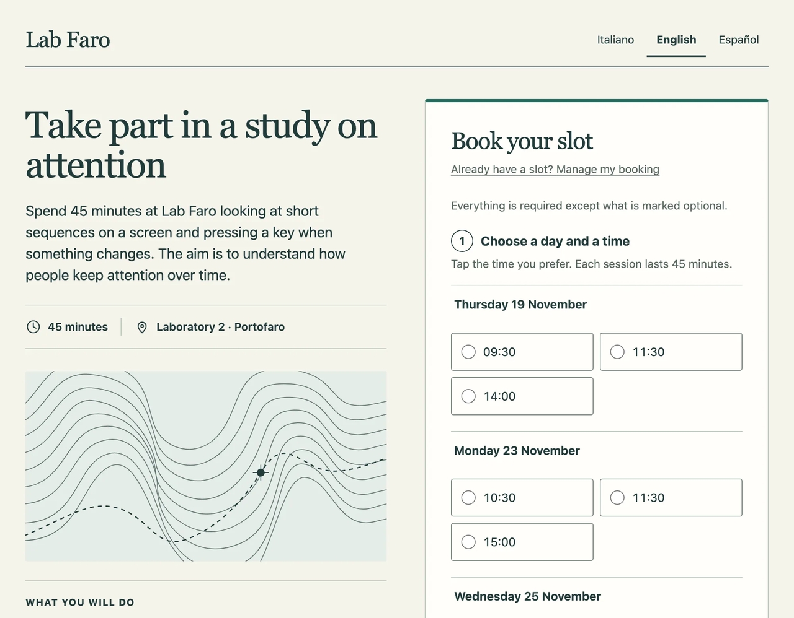
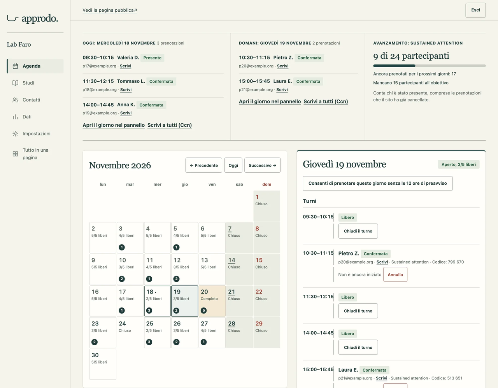
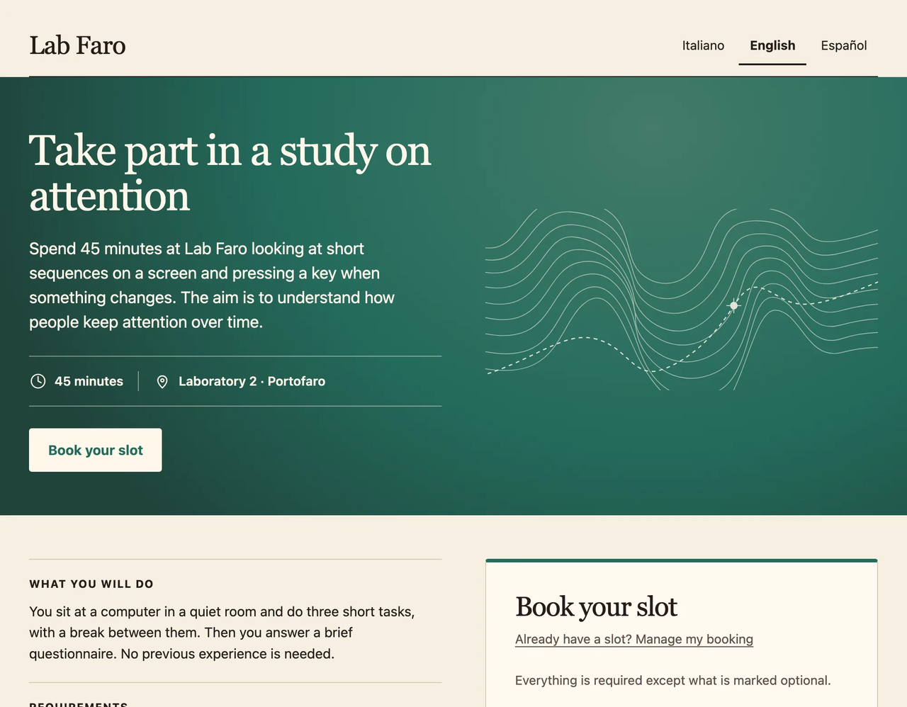

# Approdo: prenotazioni per studi con partecipanti

*English: [README.md](README.md)* · Sito del prodotto: <https://nerln.github.io/approdo/>

Approdo è un sito per far prenotare un turno a chi partecipa a uno studio di laboratorio (test con utenti, esperimenti, sessioni in realtà
virtuale), con un pannello riservato al ricercatore per aprire giorni e orari e segnare le presenze.
Si configura modificando **un solo file** (`site.config.js`) e si pubblica su Cloudflare, gratis, **senza installare niente**.
Sessioni di qualsiasi durata, con orari di inizio fissi scelti da te (per esempio alle 10:00, alle 11:00 e alle 12:00 per sessioni da 50 minuti).

[](https://deploy.workers.cloudflare.com/?url=https://github.com/nerln/approdo)





## Che cosa fa

- Chi partecipa prenota un giorno e un orario in una pagina pubblica, in italiano, inglese o spagnolo, e conferma per e-mail (o subito, senza e-mail).
- Il ricercatore, in un pannello riservato, apre giorni e orari, segna le presenze, annulla con un messaggio ed esporta i conteggi.
- Più studi, un foglio di consenso per studio, un elenco facoltativo di chi vuole sapere dei prossimi studi, promemoria facoltativi.
- Tutto ciò che è specifico del laboratorio sta in un solo file, `site.config.js`.
- Gratuito e open source. Due condizioni: citare Approdo in quello che pubblichi, e la riga «Fatto con Approdo di nerln» resta visibile in fondo alle pagine pubbliche
  ([LICENSE](LICENSE)).
- Un conteggio anonimo d'uso, attivo di default e che si spegne con una riga (qui sotto).

## Che cosa esce dalla tua installazione

Quasi niente, e quel poco è scritto qui. Una volta al giorno, quando il ricercatore apre il pannello (o arriva la chiamata
giornaliera dei promemoria del relay di posta), la tua installazione manda **un rapporto anonimo** a un piccolo raccoglitore gestito
dall'autore di Approdo. Il rapporto contiene tre valori: un identificativo casuale che la tua installazione crea la prima volta
(non deriva dall'indirizzo del sito, dal nome del laboratorio né da alcuna chiave), la versione di Approdo e il numero di sessioni
segnate come presenti da quando il sito esiste. **Non contiene indirizzo del sito, nome del laboratorio, nome dello studio, dati
di partecipanti né lingua.** Il sito del prodotto mostra i totali ("N laboratori usano Approdo"); un'installazione è contata dal secondo giorno in cui invia, e il totale delle sessioni si
pubblica solo finché sono attive almeno tre installazioni che inviano da una settimana o più, così il dato di un laboratorio non compare mai da solo.

Un altro fatto, detto chiaramente: Cloudflare aggiunge un'intestazione `CF-Worker` a ogni richiesta fatta da un Worker, e
l'intestazione indica la zona di chi invia (per esempio il tuo sottodominio `workers.dev`). Quel nome viaggia quindi col rapporto.
Il raccoglitore non lo legge, non lo registra e non lo conserva, e lo stesso vale per l'indirizzo IP e per lo user agent; il suo
codice è in [`stats-collector/`](stats-collector/), da controllare.

**Per spegnere il conteggio** scrivi una riga in `site.config.js` e ripubblica: `usageCount: false`. Non cambia nient'altro. Il
pannello (Impostazioni) dice sempre se il conteggio è attivo o spento e quando è stato fatto l'ultimo tentativo di invio. Dettagli:
[docs/privacy.md](docs/privacy.md).

## In 4 passi

1. **Premi il pulsante** qui sopra. Accedi a Cloudflare (se non hai un account lo crei, è gratuito) e a GitHub. Il modulo di
   Cloudflare mostra, in ordine: il nome del progetto (è il nome del Worker e fa parte dell'indirizzo del sito), il nome del
   repository che verrà creato nel tuo GitHub, il nome del database D1, i campi delle password e delle chiavi (`ADMIN_PASSWORD`,
   `MAIL_RELAY_URL`, `MAIL_RELAY_KEY`, `ADMIN_EMAIL`, `TURNSTILE_SITEKEY`, `TURNSTILE_SECRET`) e, tra le impostazioni avanzate, il
   comando di pubblicazione. **Scrivi solo una cosa: `ADMIN_PASSWORD`, una password di almeno 16 caratteri** (una frase lunga va
   bene: è quella che userai per entrare in `/admin`). Gli altri cinque campi lasciali come sono: i valori d'esempio che
   propongono (`change-me...`, `PASTE-YOUR-ID...`, `studio@example.org`) vengono ignorati dal sito, come se non ci fossero. I nomi del progetto, del repository e del
   database possono restare quelli proposti. **Non cambiare il comando di pubblicazione** (è `npm run deploy`, cioè `wrangler
   deploy`: crea anche le tabelle del database da solo alla prima visita). Premi il pulsante per pubblicare: Cloudflare copia il
   repository nel tuo GitHub, crea il database e pubblica il sito; in un paio di minuti è online. Se non ricordi l'indirizzo, lo
   trovi nella dashboard di Cloudflare (Workers & Pages, il tuo progetto).
2. **Personalizzalo.** Nel *tuo* nuovo repository su GitHub apri `site.config.js`, premi la matita e sostituisci i valori
   d'esempio con i tuoi: `brand` (il nome breve), `org` (gruppo, università, dipartimento, firma delle e-mail), `responsible` (chi
   è responsabile dei dati), `contactEmail` (un indirizzo del gruppo), `place` (dove ricevi i partecipanti, in ogni lingua),
   `sessionMinutes`, `slotMinutes` e `defaultTimes` (durata e orari di inizio) e `studyName` (come chiami il tuo studio, per
   esempio "studio sulla lettura"). `baseUrl` non serve: il sito usa l'indirizzo con cui lo si visita. Poi **Commit changes**.
   **Finché i valori d'esempio (Lab Esempio, Nome Cognome, studio@example.org, Via Esempio...) non sono stati sostituiti, il
   sito mostra "Questo sito non è ancora configurato" al posto del modulo e non accetta prenotazioni**: è voluto, perché nessun
   partecipante prenoti un laboratorio che non esiste. **Come vedere che la modifica ha funzionato:** aspetta uno o due minuti
   (Cloudflare ripubblica da solo a ogni commit), ricarica la pagina del sito: l'avviso sparisce e compaiono il tuo nome, il tuo
   luogo e, nella scheda "Prenota il tuo turno", la frase "Al momento non ci sono turni liberi" (finché non apri dei giorni al passo 3).
   Se non cambia niente, apri la dashboard di Cloudflare, Workers & Pages, il tuo progetto, e la scheda delle pubblicazioni
   (Deployments / Builds): il registro dell'ultima pubblicazione dice se è fallita e, se un valore di `site.config.js` è
   sbagliato, riporta una riga che inizia con `site.config.js:` e nomina la chiave da correggere. Anche la lista "Messa in
   funzione" nelle Impostazioni di `/admin` elenca, una per una, le chiavi che hanno ancora il valore d'esempio.
3. **Apri `/admin`** (l'indirizzo del sito seguito da `/admin`). Vedrai una pagina con il campo "Password": scrivi quella del
   passo 1. Dentro, apri i giorni in cui ricevi i partecipanti. Se invece vedi **"Amministrazione disattivata"**, la password non
   è stata salvata oppure è più corta di 16 caratteri: nella dashboard di Cloudflare apri il progetto, Settings, Variables and
   Secrets, aggiungi (o sostituisci) `ADMIN_PASSWORD` come Secret con una frase lunga almeno 16 caratteri e salva: vale subito,
   senza ripubblicare.
4. **Facoltativo:** le e-mail di conferma e i promemoria ([docs/posta.md](docs/posta.md)) e il controllo anti-bot (sotto, "Turnstile").
   Senza e-mail il sito funziona lo stesso: le prenotazioni sono confermate subito e non parte nessun messaggio, e le pagine pubbliche lo dicono (invitano a conservare il link della pagina e a chiedere di persona, non a cercare un'e-mail). La lista
   "Messa in funzione" nelle Impostazioni del pannello ti dice che cosa resta da fare.

Il pulsante esegue `npm run deploy` su una copia nuova, con il database creato da Cloudflare e le tabelle create dal sito. Se il pulsante non funziona sul
tuo account, usa il percorso con l'assistente (`AGENTS.md`).

Prima di annunciare il sito a dei partecipanti leggi "Privacy e obblighi" più sotto: l'informativa è un punto di partenza.

## Altri due modi

**Con un assistente di programmazione con IA** (Claude Code, Codex e simili; serve anche se non hai un account GitHub o se ti serve
il database nell'Unione Europea). Dai all'assistente una cartella con questo repository e scrivi:

> Segui AGENTS.md e metti online questo sito. Chiedimi quello che ti serve.

`AGENTS.md` è scritto per l'assistente: comandi, ordine, verifica di ogni passo e che cosa chiederti. **Le password le scrivi tu**, in
un terminale, senza dirle all'assistente.

**A mano**, dal terminale (serve Node.js 22 o più recente, https://nodejs.org). Prima sostituisci i valori d'esempio in `site.config.js`
(lo script si ferma e li elenca finché ne resta uno):

```
npm install
node scripts/setup.mjs --project nome-del-sito
```

Lo script controlla `site.config.js`, esegue i test, ti fa accedere a Cloudflare, crea il database **in Unione Europea**, pubblica il Worker (le tabelle le crea il sito stesso alla prima visita: non c'è nessuna
migrazione da lanciare) e stampa i comandi per le password (`npx wrangler secret put ...`). Si può rilanciare senza danni;
con `--dry-run` mostra i comandi senza eseguirli. I passi uno per uno sono in `AGENTS.md`.

## Note oneste

- **Perché non GitHub Pages.** GitHub Pages serve solo file statici. Questo sito ha bisogno di un server che applichi le regole (un
  solo turno per persona, preavviso minimo, orari occupati), di un database, di invio e-mail e di un pannello protetto da password.
  Per questo gira come Worker su Cloudflare (piano gratuito, con D1 come database). Il codice sta su GitHub, ma è Cloudflare a
  eseguirlo.
- **Il database del pulsante non è nell'Unione Europea per garanzia.** Con il pulsante, Cloudflare crea il database senza l'opzione
  "giurisdizione UE". Se il tuo laboratorio ha bisogno di quella garanzia, usa il percorso con l'assistente o lo script: creano il
  database con `--jurisdiction eu`. La giurisdizione si sceglie solo alla creazione.
- **L'informativa privacy è un punto di partenza.** È un testo generico, scritto per uno studio di ricerca qualsiasi: va riscritta per il tuo e fatta
  rivedere dal responsabile della protezione dei dati della tua istituzione. Finché non lo fai, il pannello tiene una riga "Da fare".
- **Sicurezza e limiti noti:** [SECURITY.md](SECURITY.md). **Licenza:** la [Attribution Assurance License](LICENSE) con una condizione
  aggiunta. Chiede due cose. Un credito visibile all'autore: in un sito fatto con Approdo è la riga in fondo alle pagine pubbliche,
  «Fatto con Approdo di nerln» con il suo link; lasciala visibile (puoi cambiarne lo stile). E una citazione: una pubblicazione, una
  tesi o un rapporto su uno studio che ha usato Approdo lo cita ([CITATION.cff](CITATION.cff)). La condizione sulla citazione è
  un'aggiunta al testo standard della licenza. La foto della pagina iniziale ha una licenza a parte ([CREDITS.md](CREDITS.md)).

## Come funziona, in una schermata

**Il partecipante** apre l'indirizzo del sito (anche da un QR sul cartello), nella lingua del suo browser o in quella che sceglie.
Legge di che studio si tratta, sceglie un giorno e un'ora tra quelli aperti, scrive un nome o alias e l'e-mail, spunta le
dichiarazioni e prenota. Riceve un'e-mail con un pulsante (o un codice di sei cifre) per confermare entro due ore, poi
l'e-mail di conferma con giorno, ora, luogo e file per il calendario, e il giorno prima un promemoria. Può annullare con un
link. Il sito non usa cookie per chi prenota.

**Il ricercatore** apre `/admin` con una password. Vede un calendario, apre i giorni (con gli orari di inizio che ha scelto) o
interi gruppi di settimane, chiude orari singoli, vede chi ha prenotato oggi e domani, segna chi è venuto e chi no, annulla
con un messaggio, scarica un CSV, prepara un invito per i prossimi studi. Riceve un'e-mail a ogni prenotazione e a ogni
annullamento.

Tutto quello che il sito dice (testi, e-mail, informativa) e tutto quello che è specifico del laboratorio (nomi, luogo,
durata, orari, lingue) sta in `site.config.js`.

## Che cosa serve

- Un **account Cloudflare gratuito** (https://dash.cloudflare.com/sign-up) e un **account GitHub** (con il pulsante).
- Facoltativo, per le e-mail: un **account Gmail dello studio, non quello personale** (da lì partono le e-mail e lì arrivano le
  risposte). Un piccolo programma di Google (Apps Script, in `apps-script/Code.gs`) le spedisce; con un Gmail normale il limite è di
  circa 100 e-mail al giorno.
- Solo per il percorso a mano o per provare in locale: **Node.js 22 o più recente**.

## Configurare tutto da `site.config.js`

`site.config.js` parte come copia di `config/example-lab.config.js` (un laboratorio inventato, "Lab Esempio", con sessioni da 50
minuti). Il file è commentato riga per riga: sostituisci i valori d'esempio (`Nome Cognome`, `studio@example.org`, `Lab Esempio`, il
luogo...) con i tuoi; finché ne resta uno il sito dice "Questo sito non è ancora configurato" e non accetta prenotazioni. Se un valore è
sbagliato il sito si ferma all'avvio con un messaggio che nomina la chiave, e `node scripts/setup.mjs` e i test lo segnalano
prima di pubblicare. Nella cartella `config/` ci sono due configurazioni complete già pronte
(`fixture-lab.config.js` è un laboratorio fittizio che serve ai test, `example-lab.config.js` quella di esempio) da usare come modello.

| Chiave | Che cosa è | Predefinito |
|---|---|---|
| `brand` | Nome breve nell'intestazione e come mittente delle e-mail | obbligatorio |
| `org.group` | Gruppo di ricerca. Un testo, oppure un oggetto con un testo per lingua (`{ it: "...", en: "..." }`): vale anche per le altre tre chiavi `org.*` | obbligatorio |
| `org.university` | Università o ente. Anche questa può essere un oggetto con un testo per lingua, così le pagine in inglese sono in inglese | obbligatorio |
| `org.unit` | Dipartimento o scuola (`""` se non lo vuoi) | `""` |
| `org.signature` | La riga che firma ogni e-mail | obbligatorio |
| `responsible` | Nome della persona responsabile, scritto nell'informativa privacy | obbligatorio |
| `contactEmail` | Indirizzo che riceve le risposte alle e-mail e gli avvisi di nuova prenotazione. Non compare nelle pagine pubbliche. La variabile `ADMIN_EMAIL` su Cloudflare lo sostituisce | obbligatorio |
| `baseUrl` | **Facoltativo.** Indirizzo pubblico del sito, senza `/` finale, per chi ha un dominio proprio e vuole link sempre uguali. Senza (e senza la variabile `BASE_URL`, che ha la precedenza) ogni link (e-mail, file di calendario, tag di anteprima) usa l'indirizzo con cui è arrivata la richiesta | non impostato |
| `timeZone` | Fuso orario IANA, per esempio `Europe/Rome`. Tutti gli orari sono ora locale di questo fuso | obbligatorio |
| `languages` | Lingue offerte: `"es"`, `"en"`, `"it"`. La prima è quella predefinita. Solo queste hanno il selettore di lingua e gli indirizzi corti `/it`, `/en` | obbligatorio |
| `adminLanguage` | Lingua del pannello di amministrazione: `"es"` o `"it"` | `"es"` |
| `sessionMinutes` | Quanto dura la sessione, come detto al partecipante (pagine, e-mail, evento di calendario) | obbligatorio |
| `slotMinutes` | Quanto calendario occupa una prenotazione: sessione più pausa. Deve essere almeno `sessionMinutes` e al massimo 720 (12 ore). Due turni dello stesso giorno devono iniziare ad almeno questa distanza | obbligatorio |
| `defaultTimes` | Orari di inizio di un giorno appena aperto (`HH:MM`, minuti qualsiasi, al massimo 12, a distanza di almeno `slotMinutes`, l'ultimo deve finire prima di mezzanotte). Si cambiano poi dal pannello | obbligatorio |
| `minNoticeHours` | Preavviso minimo per prenotare, in ore | `12` |
| `shortNoticeMinutes` | Preavviso quando il ricercatore concede l'eccezione per un giorno. È anche il preavviso minimo della modalità "Disponibile oggi": un solo numero per le due cose | `20` |
| `daysAhead` | Quanti giorni in avanti si possono aprire (56 = 8 settimane) | `56` |
| `flexDefaultUntil` | Ora di chiusura proposta dalla modalità "Disponibile oggi" | `"17:00"` |
| `place.long` | Indirizzo completo, uno per lingua: e-mail, eventi di calendario, scheda di prenotazione | obbligatorio |
| `place.short` | Etichetta breve nella pagina iniziale, una per lingua | obbligatorio |
| `place.room` | Come i testi chiamano il laboratorio ("laboratorio Esempio"), una per lingua | obbligatorio |
| `noLinkDomains` | Domini di posta (per esempio `["example.edu"]`) il cui filtro elimina i messaggi con link: chi ha un indirizzo lì riceve e-mail con un codice e senza link. La variabile `NOLINK_DOMAINS` la sostituisce | `[]` |
| `bookingRetentionDays` | Giorni dopo il turno in cui i dati della prenotazione vengono cancellati | `30` |
| `contactMonths` | Mesi in cui resta nell'elenco chi ha chiesto di essere avvisato dei prossimi studi | `24` |
| `palette` | `"paper"` o `"theatre"`: vedi «Design» | `"paper"` |
| `accent` | Il colore del laboratorio, `#rrggbb` | `"#246b5c"` |
| `hero.art` | `"contour"` (disegno a linee) o `"hologram"` (menu olografico sulla foto) | `"contour"` |
| `hero.image`, `hero.width`, `hero.height` | La foto della pagina iniziale (un file dentro `public/`, percorso come `/foto.webp`: solo lettere, cifre, `.`, `-`, `_` e `/`) e le sue misure, oppure `null` per nessuna foto (la pagina mostra allora il disegno a linee di `hero.art`) | `null` |
| `hero.ogImage` | Immagine 1200x630 per le anteprime dei link (file in `public/`, stesso tipo di percorso), o `null` | `null` |
| `hero.creditHtml` | Riga di crediti della foto, HTML scritto da te, uno per lingua, o `null`. La foto inclusa richiede il credito | `null` |
| `twoStudies` | `true`: il sito presenta due studi di seguito (scheda "Due studi" e interruttore dello studio attivo nel pannello). `false`: un solo studio, la scheda e l'interruttore spariscono e si usano sempre i testi di `study1` | `true` |
| `declarations.epilepsy` | `true`: casella "Non soffro né ho mai sofferto di epilessia" (controllata anche dal server), riga nei requisiti, nelle condizioni e nell'informativa. `false`: niente di tutto questo | `true` |
| `declarations.vestibular` | `"study2"`: la dichiarazione sui disturbi vestibolari si chiede solo per il secondo studio (serve `twoStudies: true`); `"always"`: sempre; `"never"`: mai, e non se ne parla da nessuna parte | `"study2"` |
| `privacyReviewed` | Scrivi `true` solo dopo che l'ufficio per la protezione dei dati della tua istituzione ha rivisto l'informativa. Finché è `false`, la lista "Messa in funzione" del pannello ha una riga "Da fare" e `scripts/setup.mjs` stampa un avviso | `false` |
| `legacyPaths` | `false`: le pagine in italiano e inglese usano gli indirizzi `/terms`, `/privacy`, `/book`, `/manage`, `/unsubscribe` (quelle in spagnolo `/condiciones`, `/privacidad`, `/reservar`, `/gestionar`, `/baja`; i due modi funzionano sempre). `true`: indirizzi spagnoli ovunque, per chi ha già link in giro | `false` |
| `usageCount` | `true`: una volta al giorno l'installazione manda un rapporto anonimo (identificativo casuale, versione, numero di sessioni con presenza) all'autore di Approdo; vedi "Che cosa esce dalla tua installazione". `false`: non viene mai inviato nulla | `true` |
| `studyName` | Come si chiama lo studio negli oggetti delle e-mail, nel titolo dell'evento di calendario, nell'invito e nei testi predefiniti: un testo, oppure uno per lingua (`{ it: "studio sulla lettura", en: "reading study", es: "..." }`). Deve stare dopo "un/uno" ("a" in inglese) | "studio di ricerca" / "research study" / "estudio de investigación" |
| `minAdminPasswordLength` | Lunghezza minima di `ADMIN_PASSWORD`: una password più corta conta come non impostata (il pannello resta chiuso e dice perché). Non abbassarla su un sito vero | `16` |
| `texts` | Sostituzioni dei testi pubblici per lingua: descrizione dello studio, requisiti, informativa. Quali chiavi descrivono lo studio e vanno riscritte: [docs/testi.md](docs/testi.md). Il formato: [docs/configurazione.md](docs/configurazione.md) | `{}` |

Dettagli di ogni chiave, come riscrivere i testi, e gli errori più comuni: [docs/configurazione.md](docs/configurazione.md).

### Esempio 1: sessioni da 50 minuti, un inizio ogni 60 minuti

La durata della sessione e la distanza tra un inizio e l'altro sono due impostazioni separate. La sessione dura 50 minuti (`sessionMinutes`). Tra l'inizio di una e l'inizio della
successiva devono passare almeno 60 minuti (`slotMinutes`), quindi tra una sessione e l'altra restano 10 minuti. Gli orari di inizio li scegli tu:

```js
sessionMinutes: 50,
slotMinutes: 60,
defaultTimes: ["10:00", "11:00", "12:00"],
```

Il partecipante legge "dalle 10:00 alle 10:50" (la durata della sessione); il calendario del sito considera quel turno occupato
fino alle 11:00, quindi nessun'altra prenotazione può cominciare prima. Ogni giorno aperto offre questi tre orari, quelli e
nessun altro: se un giorno ti serve un orario in più o in meno, lo apri o lo chiudi dal pannello. Se scrivi orari troppo
vicini (per esempio 10:00 e 10:30) il sito rifiuta la configurazione con un messaggio che lo spiega.

### Esempio 2: sessione da 45 minuti, un inizio ogni 45 minuti

```js
sessionMinutes: 45,
slotMinutes: 45,
defaultTimes: ["09:00", "09:45", "10:30", "11:15", "13:00", "13:45", "14:30"],
```

Non c'è pausa: `slotMinutes` è uguale a `sessionMinutes` e un turno inizia quando finisce il precedente. Gli orari
possono avere qualunque minuto: non devono essere "tondi".

## Design

L'aspetto è carta calda, titoli con grazie, filetti sottili, tema chiaro e scuro, nessun font scaricato. Il colore del tuo laboratorio è la chiave `accent` di `site.config.js` (`#rrggbb`, predefinito verde petrolio; il sito lo serve come `/theme.css`). Il disegno della pagina iniziale è `hero.art` (`"contour"` o `"hologram"`) oppure la tua foto `hero.image`. In fondo alle pagine pubbliche compare, discreta, la riga «Fatto con Approdo di nerln»: la licenza chiede di lasciarla (puoi cambiarne lo stile).

Le tavolozze sono due, scelte con la chiave `palette`:

- `"paper"` (predefinita): carta calda e inchiostro blu-verde, come nelle immagini qui sopra.
- `"theatre"`: per un laboratorio il cui studio e i cui cartelli hanno un'identità rosso scuro, da palcoscenico. Carta color crema, inchiostro nero caldo (nessuna sfumatura verde) e il tuo `accent` per le voci attive. Nella pagina iniziale una fascia a tutta larghezza nel colore `accent`, con una luce morbida come un sipario sotto un faro, contiene titolo, introduzione, dati e pulsante in testo crema; la foto sta accanto (sotto, sul telefono), posata sulla fascia senza riquadro: deve essere un ritaglio con sfondo trasparente. Con `hero.art: "hologram"` il disegno decorativo e la sua animazione unica sono disegnati sopra la foto. La fascia è uguale nel tema chiaro e nel tema scuro e il testo passa a scuro se `accent` è un colore chiaro (per esempio `#f0c040`). Il pannello usa gli stessi inchiostri.



`node scripts/check-contrast.mjs` controlla i contrasti di entrambe le tavolozze nei due temi, anche con un tuo colore (`node scripts/check-contrast.mjs "#rrggbb"`). Dettagli in `docs/configurazione.md`.

## Il pannello di amministrazione, giorno per giorno

Apri `https://<il-tuo-sito>/admin` e scrivi la password. Il pannello è nella lingua di `adminLanguage` (qui i nomi sono quelli
italiani; il pannello spagnolo ha gli stessi elementi, vedi la tabella nel riferimento tecnico in fondo).

Il pannello ha **cinque sezioni**, scelte con la barra in alto (semplici link, nessuno script): **Agenda** (oggi e domani, il calendario
del mese, il giorno scelto, le prossime prenotazioni e, se hai fissato un obiettivo, l'avanzamento dello studio attivo), **Studi**
(testi, dichiarazioni e obiettivo di ogni studio), **Contatti** (l'elenco per studi futuri e gli inviti), **Dati** (i tre download) e
**Impostazioni** (modalità di conferma, orari predefiniti, pausa, strumenti, messa in funzione). "Tutto in una pagina" (`/admin?s=all`) le mostra
tutte una dopo l'altra. Ogni modulo torna alla sezione da cui è partito e il messaggio compare lì. Nel calendario sabato e domenica
hanno una classe propria: il numero della domenica e l'intestazione della colonna sono rossi nei due temi, e l'etichetta
accessibile di ogni cella dice il giorno della settimana.

- **Aprire i giorni.** Dal calendario del mese scegli un giorno e aprilo: ottiene gli orari predefiniti. C'è anche l'azione
  rapida per aprire in una volta la settimana (lunedì-venerdì) o 1, 2, 4 o 8 settimane. Si aprono solo giorni futuri entro
  `daysAhead`. Un giorno con prenotazioni in attesa o confermate non si può chiudere: prima annulli quelle.
- **Cambiare gli orari di inizio.** Per sempre (per i giorni che aprirai da ora): Impostazioni, orari predefiniti, scrivi
  `HH:MM` separati da virgola. Il sito rifiuta orari che si sovrappongono (meno di `slotMinutes` tra due inizi) e un ultimo
  turno che finisce dopo mezzanotte. Per un singolo giorno già aperto: nel pannello del giorno apri o chiudi i singoli orari.
- **L'eccezione sul preavviso, giorno per giorno.** Di solito si prenota con almeno `minNoticeHours` ore di anticipo. Se un
  giorno vuoi accettare prenotazioni all'ultimo momento, nel pannello di quel giorno attivi l'eccezione: si potrà prenotare
  fino a `shortNoticeMinutes` minuti prima di ogni turno libero. Chiudi prima i turni in cui non ci sarai. La si toglie con lo
  stesso pulsante.
- **Disponibile oggi.** Se sei in laboratorio e vuoi accogliere qualcuno oggi, scrivi "dalle" e "alle" (alle `flexDefaultUntil`
  per impostazione predefinita) e attiva: il pubblico può prenotare oggi con `shortNoticeMinutes` minuti di preavviso (20 per impostazione predefinita), in turni consecutivi
  dall'ora attuale (su una griglia di 5 minuti) fino all'ora che hai indicato. Finché è attivo, per oggi il pubblico vede questi
  orari e non quelli normali.
- **Pausa giornaliera.** In Impostazioni, «Pausa»: scrivi "dalle" e "alle" (per esempio l'ora di pranzo) e salva. Nessun turno la
  cui sessione si sovrapponga a quell'intervallo viene offerto, in nessun giorno e nemmeno in "Disponibile oggi"; le prenotazioni già
  fatte restano. La togli con lo stesso modulo.
- **Modalità di conferma.** In Impostazioni scegli come si confermano le prenotazioni: "Via e-mail" (predefinito, con il relay
  acceso: la persona deve confermare con il pulsante o il codice entro due ore, altrimenti il posto si libera) oppure "Subito"
  (la prenotazione vale immediatamente; l'e-mail di conferma parte lo stesso). Senza relay di posta la conferma è sempre
  immediata.
- **Oggi e domani.** In cima trovi chi ha prenotato per oggi e domani: ora, nome, stato, indirizzo, un link per scrivergli e,
  con due o più persone, "Scrivi a tutti (Ccn)" (indirizzi in copia nascosta). Il pannello del giorno mostra anche, sotto ogni
  prenotazione, quali e-mail sono partite e quali no.
- **Presenze.** Dopo l'inizio del turno segna "Presente" o "Assente". Chi non è venuto può ricevere, una volta e a mano, la
  proposta di scegliere un altro turno. Chi è venuto non può prenotare di nuovo con lo stesso indirizzo lo studio attivo.
- **Annullare.** Dal pannello puoi annullare una prenotazione scrivendo un messaggio facoltativo (500 caratteri) per la persona;
  il pannello ti dice se l'e-mail è partita.
- **Dati e download.** La sezione Dati ha tre blocchi separati, e ognuno dice a parole se contiene dati personali.
  *Riepilogo senza nomi né e-mail*: una riga per studio e per settimana (prenotati, presenti, assenti, annullati, non segnati) più un
  totale per studio con l'obiettivo; somma le prenotazioni di adesso e i conteggi per settimana che il sito conserva quando cancella quelle
  vecchie (CSV `riepilogo`, con l'identificativo dello studio). Chi sa chi è venuto in una certa settimana potrebbe comunque collegare un
  conteggio a una persona. *Prenotazioni con nomi ed e-mail* (file `prenotazioni-con-dati-personali-<data>.csv`): alias, e-mail, studio, data, ora, stato, lingua, promemoria e se l'e-mail è stata confermata. Contiene dati personali, è per il
  tuo uso di ricercatore: il sito la cancella `bookingRetentionDays` giorni dopo ogni turno, quindi esporta prima, e cancella il file
  dal tuo computer quando lo studio finisce. *Contatti che hanno accettato gli avvisi*: anch'esso con dati personali (e-mail).
- **Elenco per studi futuri.** Chi, prenotando, ha chiesto di essere avvisato dei prossimi studi entra nell'elenco dopo aver
  partecipato (o confermato l'e-mail), per `contactMonths` mesi. Nel pannello vedi quante persone sono, puoi esportarle in CSV
  e preparare un invito: il sito prepara il testo e i link che si aprono nel tuo programma di posta con gli indirizzi in copia
  nascosta e, in fondo, come cancellarsi. **Il sito non invia l'invito**: lo mandi tu. Chi vuole uscire dall'elenco lo fa dalla
  pagina di cancellazione.
- **Studi dal pannello.** Finché dal pannello non salvi uno studio, gli studi sono quelli di `site.config.js` (`twoStudies`, `declarations`,
  `texts`). Il **primo salvataggio** (anche solo "Nuovo studio") copia nella tabella `studies` tutti gli studi
  della configurazione, **senza copiare nessun testo**: una riga conserva solo ciò che è diverso dal testo di serie, quindi salvare senza
  cambiare niente non cambia niente. Da quel momento la fonte è il pannello: titolo, descrizione, "cosa farai"
  e requisiti per ogni lingua, le dichiarazioni (epilessia, disturbi vestibolari), un obiettivo di partecipanti, come lo studio compare
  nell'elenco pubblico (nascosto, più avanti, già concluso), "Attiva questo studio", "Salva e attiva questo studio",
  "Archivia questo studio" (mai cancellato) e "Nuovo studio". Un salvataggio rifiutato, o fatto mentre lo studio cambiava, ti restituisce lo stesso modulo con ciò che avevi scritto. Come si fa, con i limiti di lunghezza: [docs/studi.md](docs/studi.md). Se hai un solo studio e non vuoi
  la sezione, non la usi: nulla cambia. I testi del sito di serie si riscrivono come spiega [docs/testi.md](docs/testi.md).
- **Foglio di consenso informato.** Per ogni studio e lingua puoi compilare dal pannello il contenuto del foglio che la persona firma su
  carta prima della sessione (titolo, descrizione, procedura, rischi, dati, conservazione, titolare, permessi facoltativi) e aprire la pagina
  da stampare in A4 (`/admin/consent?study=<id>&lang=<lingua>`, che apre il pulsante dell'editor), nero su bianco e senza script: usi il comando Stampa del browser. Un campo vuoto stampa un testo di serie
  prudente, con fra parentesi quadre le parti che solo il tuo laboratorio può sapere. **È un punto di partenza: deve essere rivisto dal comitato
  etico o dall'ufficio per la protezione dei dati** della tua istituzione. L'editor mostra cosa dice la pagina pubblica e avvisa se il foglio
  non nomina l'epilessia quando il modulo la chiede. Sul foglio il blocco della persona (nome in stampatello, data, firma) precede quello del ricercatore
  (un interruttore mette per primo il blocco del ricercatore), in fondo c'è una riga con il nome dello studio e la data dell'ultima modifica, e la striscia
  sullo schermo conta le parentesi quadre che restano. Dettagli: [docs/consenso.md](docs/consenso.md).
- **Avanzamento.** Se lo studio attivo ha un obiettivo, in cima all'Agenda vedi "N di M partecipanti", una barra, quanti sono ancora
  prenotati per i prossimi giorni e quanti ne mancano. Contano come fatte le prenotazioni segnate "Presente", comprese quelle già cancellate
  dal sito (che conserva solo conteggi per settimana: vedi [docs/privacy.md](docs/privacy.md)). Per i partecipanti fatti senza la pagina di
  prenotazione imposti «Partecipanti fatti al di fuori del sito» (nel modulo dello studio o in un piccolo modulo sotto l'avanzamento): si somma al numero dei partecipanti già fatti.
- **Strumenti.** "Invia e-mail di prova" (a `ADMIN_EMAIL` se è impostata, altrimenti a `contactEmail`), "Invia i promemoria di domani" (utile per provare), e la lista
  "Messa in funzione" che dice se password, relay, promemoria automatici e controllo anti-bot sono a posto.

## I limiti che proteggono il sito

| Protezione | Valore | Dove si cambia |
|---|---|---|
| Preavviso minimo per prenotare | 12 ore | `minNoticeHours` in `site.config.js`; eccezione per un giorno o "Disponibile oggi" dal pannello |
| Una prenotazione viva per indirizzo e-mail | sempre | Si valuta l'indirizzo normalizzato (maiuscole, `+etichetta`, punti di Gmail); chi è già venuto non prenota di nuovo lo studio attivo. Non è configurabile |
| Posto trattenuto in attesa di conferma | 2 ore (o fino all'inizio del turno, per prenotazioni all'ultimo momento) | Nel codice (`PENDING_MS` in `src/app.js`) |
| Richieste per rete | 20 richieste/10 min per indirizzo di rete (se ne tiene solo un'impronta con sale giornaliero) | Nel codice (`RATE_MAX` in `src/app.js`). Una classe nella stessa rete condivide un indirizzo: se serve, alzalo |
| E-mail di conferma | al massimo 30 richieste all'ora per tutto il sito; con 80 e-mail in 24 ore non si accettano nuove prenotazioni, con 50 smettono gli avvisi a te per ogni conferma | Nel codice (`MAIL_BRAKE_MAX` in `src/app.js`, `MAIL_DAY_MAX` e `MAIL_ADMIN_SKIP` in `src/mail.js`). Pensati per il limite di 100 e-mail al giorno di Gmail |
| Tentativi di codice sbagliato | 5 ogni 15 minuti per e-mail | Nel codice (`CODE_MAX` in `src/app.js`) |
| Accesso al pannello | blocco dopo 5 errori in 15 minuti | Nel codice |
| Controllo anti-bot | campo trappola nascosto, almeno 4 secondi tra apertura e invio del modulo, indirizzi e-mail usa-e-getta rifiutati; in più Cloudflare Turnstile se lo attivi | Turnstile: vedi sotto |

I valori "nel codice" sono costanti in `src/`: cambiarli è una modifica da programmatore (chiedila al tuo assistente) e la suite
di test di regressione (`npm test`) fissa i valori originali, quindi quel test va aggiornato insieme alla costante.

**Attivare Turnstile (controllo anti-bot di Cloudflare, facoltativo).** Nella dashboard Cloudflare: Turnstile, Add widget, nome a
piacere, hostname dell'indirizzo del sito (per esempio `approdo.tuo-nome.workers.dev`), modalità Managed. Ottieni una chiave del
sito e una chiave segreta. Impostale come password del Worker: nella dashboard (Workers & Pages, il tuo sito, Settings, Variables
and Secrets, sostituisci i valori `change-me`) oppure dal terminale:

```
npx wrangler secret put TURNSTILE_SITEKEY
npx wrangler secret put TURNSTILE_SECRET
```

Valgono subito, senza ripubblicare. Servono entrambe, altrimenti il controllo resta spento. All'inizio il pannello lo mostra "in osservazione": non blocca nessuno
finché un controllo non è riuscito almeno una volta. Con Turnstile attivo chi prenota ha bisogno di JavaScript nel browser.

## Privacy e obblighi

- **L'informativa che trovi nel sito è un punto di partenza.** È scritta in modo generale. Ogni istituzione deve farla
  controllare dal proprio responsabile della protezione dei dati (DPO) e adattarla (`texts` in `site.config.js`, vedi
  [docs/testi.md](docs/testi.md)) prima di annunciare il sito; quando è fatto, scrivi `privacyReviewed: true`. Lo stesso vale per
  le condizioni di partecipazione e per le dichiarazioni sul modulo (di serie, assenza di epilessia e di disturbi
  vestibolari; le spegni con `declarations`).
- **Se il repository è pubblico** (con il pulsante lo è). Il codice si può pubblicare senza rischi per il sito: le password (`ADMIN_PASSWORD`, la chiave e
  l'indirizzo del relay di posta, Turnstile) stanno solo nei segreti di Cloudflare e in `.dev.vars` (ignorato da git), mai in un
  file del repository; il `database_id` in `wrangler.jsonc` non è un segreto; il sito non contiene dati di partecipanti, che vivono
  nel database. Tutto quello che scrivi in `site.config.js` invece diventa pubblico, e questo include `contactEmail` e `responsible`:
  usa un indirizzo di gruppo (non personale) e scrivi un nome solo se la persona è d'accordo.
- **Che cosa si conserva.** Per ogni prenotazione: nome o alias, e-mail, giorno e ora, stato, lingua e date di creazione e
  conferma. Nessun indirizzo IP e nessun codice partecipante: i dati di prenotazione non si collegano ai dati dello studio. Si
  tiene un'impronta dell'indirizzo di rete, con sale giornaliero, per un'ora (limite di richieste). L'elenco per studi futuri
  tiene solo e-mail e lingua.
- **Per quanto tempo.** Le prenotazioni si cancellano `bookingRetentionDays` giorni dopo il turno (anche quelle annullate: annullare
  non cancella prima). Quelle non confermate si cancellano dopo 2 ore. Il registro delle e-mail inviate (senza testo) dopo 60 giorni.
  I contatti per studi futuri dopo `contactMonths` mesi o quando la persona esce dall'elenco.
- **Cancellare i dati di una persona che lo chiede.** Prima del termine automatico, si fa a mano: [docs/privacy.md](docs/privacy.md)
  ha i comandi e le precauzioni.
- **Il conteggio anonimo d'uso.** Una volta al giorno l'installazione comunica all'autore di Approdo un identificativo casuale, la versione e il numero di sessioni con presenza; niente sul sito, sul laboratorio o sui partecipanti. È attivo di default e `usageCount: false` lo spegne. Vedi "Che cosa esce dalla tua installazione" sopra e [docs/privacy.md](docs/privacy.md).
- **Chi tratta i dati.** Cloudflare (sito e database; nell'Unione Europea solo se il database è stato creato con la giurisdizione UE, vedi sotto) e Google (invio delle e-mail, solo se il relay è
  acceso). Va indicato nell'informativa e valutato dal DPO.

Più dettagli in [docs/privacy.md](docs/privacy.md).

## Se qualcosa non va

**Le e-mail non arrivano a indirizzi universitari.** Alcuni filtri di posta universitari eliminano in silenzio i messaggi che
contengono link. Aggiungi il dominio a `noLinkDomains` (per esempio `["example.edu"]`) e pubblica di nuovo: chi ha un indirizzo di
quel dominio riceve e-mail senza link, con un codice di sei cifre da scrivere nella pagina "Gestisci la mia prenotazione". Se
l'e-mail non arriva a nessuno, guarda prima nella cartella della posta indesiderata, poi nel pannello del giorno la riga "E-mail:"
sotto la prenotazione, che dice cosa è partito e l'errore del relay. `bad signature` vuol dire che la chiave del relay in
Apps Script e `MAIL_RELAY_KEY` su Cloudflare sono diverse; `quota`, che il limite giornaliero è esaurito. Altri casi in
[docs/posta.md](docs/posta.md).

**Il limite giornaliero di e-mail.** Un account Gmail normale spedisce circa 100 e-mail al giorno (gli account Google Workspace di
più, secondo le regole di Google). Il sito si ferma prima: con 80 e-mail in 24 ore non accetta nuove prenotazioni finché il
numero non scende, e da 50 non ti avvisa più a ogni conferma. Il conteggio è nella lista "Messa in funzione". Un
promemoria o una conferma di prenotazioni già fatte hanno sempre la precedenza. Un gruppo grande di persone nello stesso giorno
(una classe) può consumare il limite: distribuisci gli inviti.

**Il controllo anti-bot.** Se una persona legittima non riesce a prenotare: "Troppi tentativi" (il titolo della pagina; il testo dice "troppe richieste") significa che la sua rete ha
fatto più di 20 richieste in 10 minuti (una classe nella stessa rete); aspetta o alza `RATE_MAX`. Con Turnstile, controlla che
l'hostname del widget sia identico a quello del sito e che la persona non blocchi gli script di Cloudflare. Un modulo inviato
in meno di 4 secondi dall'apertura viene rifiutato: basta riprovare.

**Il sito dice che manca il database, o `/admin` dà "Amministrazione disattivata".** Il database non è collegato al Worker, oppure la password `ADMIN_PASSWORD` manca o è ancora quella di esempio (`change-me...`) o è più corta di `minAdminPasswordLength` (16): impostala come spiega il
passo 3, e vedi l'ultima tabella di `AGENTS.md`.

## Provare in locale, senza Cloudflare

Il modo più semplice per vedere il sito:

```
node scripts/preview.mjs
```

All'avvio stampa, in inglese, l'indirizzo (`http://localhost:8799`), quello del pannello (`/admin`) e la password per entrarvi
(una password casuale nuova a ogni avvio, valida solo per quell'anteprima). Il database è in memoria (si svuota a ogni avvio), non parte nessuna
e-mail e non si tocca nulla online; ci sono sei giorni feriali già aperti con gli orari di `site.config.js`. Si ferma con Ctrl+C.
Con un'altra porta: `node scripts/preview.mjs 8801`. Con un orologio fisso, per provare le presenze, la pulizia e il riepilogo senza aspettare:
`node scripts/preview.mjs --now 2026-11-16T10:00:00+01:00` (un istante ISO con il suo fuso).

Per provarlo invece sul motore vero di Cloudflare (database D1 locale; non serve né il login né la rete), in questa sequenza,
verificata:

```
npm install
echo "ADMIN_PASSWORD=una-password-locale-lunga" > .dev.vars
npm run dev
```

`npm install` scarica Wrangler, la seconda riga scrive una password di prova per `/admin` (di almeno 16 caratteri) in `.dev.vars` (file ignorato da git:
non ripetere questa riga se il file esiste già) e `npm run dev` avvia il sito su http://localhost:8787 con un database locale (cartella `.wrangler/`) che
all'inizio è vuoto: le tabelle le crea il sito stesso alla prima richiesta, senza nessun comando di migrazione. Per usare un'altra porta: `npm run dev -- --port 8790`. Da un altro terminale: `curl -s -o /dev/null -w "%{http_code}\n" http://localhost:8787/` e la
stessa cosa con `/admin` devono stampare `200`; una pagina che non esiste dà `404`. Per fermarlo: Ctrl+C. Il database locale è
vuoto: apri qualche giorno da `/admin` per vedere i turni. I valori di `.dev.vars.example` (`change-me...`) contano come non
impostati: con quelli il pannello resta chiuso e non c'è né e-mail né controllo anti-bot.

I test:

| Comando | Che cosa prova |
|---|---|
| `npm test` | la suite di regressione, contro un laboratorio fittizio completo (`config/fixture-lab.config.js`): il comportamento fissato dai test non cambia |
| `npm run test:generic` | la suite indipendente dalla configurazione, contro l'esempio (`config/example-lab.config.js`) |
| `npm run test:variants` | la stessa suite contro ognuna delle piccole configurazioni di `config/test-variants/` (dichiarazioni spente, uno studio solo, altre lingue, e `realistic-edit`: l'esempio con valori veri, come lo lascia chi lo ha compilato) |
| `npm run test:all` | i tre comandi sopra, uno dopo l'altro |
| `node scripts/test.mjs site.config.js --suite test-generic` | la **tua** configurazione |

Ognuno lavora su una copia temporanea e non modifica i tuoi file. Per stampare il cartello con il QR code: `npm install` e
`npm run qr -- https://il-tuo-sito/`.

## Aggiornare, GitHub e smontare

Per aggiornare il sito a una versione nuova del modello (il database si aggiorna da solo alla prima visita) vedi
[docs/aggiornare.md](docs/aggiornare.md). Se vuoi che ogni modifica caricata su GitHub pubblichi il sito da sola, dopo i
test, c'è un flusso facoltativo in `.github/workflows/deploy.yml` (istruzioni nel file). Per spegnere tutto: `AGENTS.md`,
sezione "Tearing down".

## Mappa dei file

| File | A che cosa serve |
|---|---|
| `site.config.js` | **L'unico file da modificare** |
| `config/` | Due configurazioni complete di esempio (`fixture-lab.config.js`, il laboratorio fittizio dei test, e `example-lab.config.js`) e, in `config/test-variants/`, le piccole varianti usate dai test |
| `AGENTS.md` | La procedura di pubblicazione per un assistente IA |
| `scripts/setup.mjs`, `setup.sh` | Installazione da terminale (database in UE) di tutto ciò che non richiede password. Si ferma (codice 1) finché in `site.config.js` c'è un segnaposto, e avvisa finché `privacyReviewed` è `false` |
| `scripts/preview.mjs` | L'anteprima locale in memoria |
| `scripts/check-contrast.mjs` | Controllo dei contrasti delle due tavolozze nei due temi |
| `wrangler.jsonc` | Configurazione del Worker Cloudflare: nome, database D1, file statici. Con il pulsante il database lo crea Cloudflare; lo script scrive qui il `database_id` |
| `package.json` | Comandi (`npm run deploy`, che è soltanto `wrangler deploy`, `npm run dev`, `npm run build:schema`, i test) e le descrizioni dei campi che il pulsante chiede |
| `PUBLISHING.md`, `scripts/set-owner.mjs` | Per chi pubblica una copia del repository: mette il tuo account GitHub nell'indirizzo del repository, al posto del segnaposto o dell'account di chi ha pubblicato la copia da cui sei partito |
| `docs/img/` | Le immagini di questo file |
| `LICENSE`, `CREDITS.md`, `SECURITY.md`, `CITATION.cff` | Licenza del codice (Attribution Assurance License: termini BSD più un credito visibile), licenza a parte della foto, sicurezza e limiti noti, come citare Approdo |
| `apps-script/Code.gs` | Il relay di posta per Google Apps Script |
| `schema.sql`, `src/schema.js`, `src/migrate.js` | Tabelle del database: `schema.sql` è l'unica fonte, `src/schema.js` ne è la copia generata (`npm run build:schema`) e `src/migrate.js` le crea e le aggiorna da solo alla prima richiesta |
| `src/`, `public/` | Il codice del sito (non si modifica per configurarlo). `src/usage.js` è il conteggio anonimo d'uso |
| `stats-collector/` | Il sorgente del piccolo Worker che riceve i rapporti d'uso e pubblica i totali. Non si pubblica con il tuo sito: non ti serve |
| `test/`, `test-generic/` | I test |
| `docs/` | Guide: configurazione, testi dello studio, studi dal pannello ([docs/studi.md](docs/studi.md)), foglio di consenso ([docs/consenso.md](docs/consenso.md)), posta, privacy, aggiornamenti |

## Riferimento tecnico

Per chi sviluppa o per l'assistente IA. Il comportamento descritto qui è quello del codice in `src/`.

- **Stack.** Un Cloudflare Worker con file statici (`wrangler.jsonc`: `src/index.js` risponde a ogni richiesta e chiama `src/app.js`; i file di `public/` passano da `env.ASSETS`), D1, HTML generato dal server con una
  Content-Security-Policy rigida (nessuno stile o script in linea), nessun cookie per i partecipanti. Il pannello usa solo HTML e
  CSS. Ogni valore interpolato è escapato e ogni istruzione SQL ha parametri vincolati. La tavolozza e l'accento arrivano alle pagine come `/theme.css` e una classe su `<body>`, mai come attributo `style`.
- **E-mail.** Un'e-mail su una prenotazione passa da `sendLogged` (`src/mail.js`), che invia e scrive una riga in `mail_log` (tipi
  `confirm_request`, `confirmed`, `reminder`, `cancelled`, `noshow`, `admin`, `test`; righe cancellate dopo 60 giorni). Lettura
  e scrittura del registro tollerano la tabella mancante. Se il relay fallisce durante la prenotazione nella modalità "Via e-mail", la prenotazione si
  cancella e l'ultimo errore resta in `settings.mail_fail_last`, mostrato nella lista "Messa in funzione". Nella modalità "Subito" la prenotazione resta confermata e si registra solo l'errore. Il relay firma con
  HMAC-SHA256 il corpo (la firma viaggia nel parametro `?sig=`); la proprietà `REPLY_TO` dello script indica l'indirizzo cui
  arrivano le risposte; con la quota esaurita il relay risponde `{ok:false, error:'quota'}`.
- **Promemoria.** Il sito non ha un cron suo: il relay in Apps Script chiama `POST /cron/remind` una volta al giorno (firmato con la stessa
  chiave). Ogni prenotazione si "reclama" prima di inviare e si libera se l'invio fallisce. Il risultato (`at`, `sent`, `failed`)
  è in `settings.cron_result`; la lista "Messa in funzione" lo segna "Fatto" se la chiamata ha meno di 26 ore.
- **Pulizia.** Opportunistica a ogni richiesta dinamica, al massimo una volta al minuto: prenotazioni in attesa scadute,
  prenotazioni oltre `bookingRetentionDays` (prima di cancellarle le conta per settimana nella tabella `tallies`, nello stesso `db.batch`), righe di limite e di tentativi di accesso oltre un'ora, registro e-mail oltre 60 giorni.
- **Database.** Nessuna migrazione da lanciare: la creazione automatica del database di Wrangler avviene solo durante la pubblicazione, quindi "applica
  le migrazioni, poi pubblica" non funzionerebbe su un clone nuovo. `src/migrate.js` (`ensureSchema`) legge una volta per istanza la
  riga `schema_version` di `settings`: se la tabella non c'è crea tutto con un `db.batch` di istruzioni `CREATE ... IF NOT EXISTS`
  (tratte da `src/schema.js`, generato da `schema.sql`), se la versione è più vecchia esegue gli aggiornamenti idempotenti, e poi
  non fa più nessuna domanda. La versione 2 dello schema aggiunge `studies` (gli studi gestiti dal pannello: `data` è JSON con nome, obiettivo,
  archiviato, dichiarazioni, stato pubblico e i soli testi che differiscono da quelli di serie; vuota finché non salvi uno studio) e `tallies`; la versione 3
  porta `tallies` a conteggi **per settimana ISO** (studio, lunedì, stato: senza nomi né e-mail, mai cancellata; i conteggi per giorno già
  esistenti vengono sommati nel lunedì della loro settimana). Come cambiare lo schema in futuro: [docs/aggiornare.md](docs/aggiornare.md).
- **Etichette del pannello.** Con `adminLanguage: "es"` le sezioni si chiamano "Hoy y mañana" (italiano: "Oggi e domani"),
  "Próximas reservas" ("Prossime prenotazioni"), "Ajustes" ("Impostazioni"), "Puesta en marcha" ("Messa in funzione"),
  "Invitar" ("Invita"), "Disponible hoy" ("Disponibile oggi"), "Asistió" / "No vino" ("Presente" / "Assente"). Le sezioni: "Agenda",
  "Estudios" ("Studi"), "Contactos" ("Contatti"), "Datos" ("Dati"), "Ajustes" ("Impostazioni").
- **Test.** `scripts/test.mjs [percorso-config] [--suite test|test-generic]` copia il progetto in una cartella temporanea, vi scrive
  la configurazione scelta come `site.config.js` ed esegue `node --test`: la configurazione non si cambia mai a runtime.
- **Variabili e password su Cloudflare.** Password (`npx wrangler secret put NOME`, o la dashboard): `ADMIN_PASSWORD`, `MAIL_RELAY_URL`,
  `MAIL_RELAY_KEY`, `ADMIN_EMAIL`, `TURNSTILE_SITEKEY`, `TURNSTILE_SECRET`: sono quelle che il pulsante chiede (l'elenco è
  `.dev.vars.example`, le descrizioni sono in `package.json`, campo `cloudflare.bindings`). Un valore ancora uguale all'esempio
  (`change-me...`) o vuoto conta come non impostato (`src/env.js`). Facoltative, e di norma meglio scritte in `site.config.js`:
  `BASE_URL` (facoltativa: di norma non serve, vedi `baseUrl`), `NOLINK_DOMAINS` (se le metti nella dashboard come variabili semplici, ogni pubblicazione le cancella; come segreti
  restano). In locale, nello stesso modo, in `.dev.vars` (si parte da `.dev.vars.example`; non va mai versionato).

## Crediti

Costruito da nerln. La foto della pagina iniziale ha una licenza a parte: [CREDITS.md](CREDITS.md).

Se usi Approdo in uno studio, citalo (lo chiede la licenza): il riferimento è in [CITATION.cff](CITATION.cff), e GitHub lo mostra sotto
«Cite this repository».
