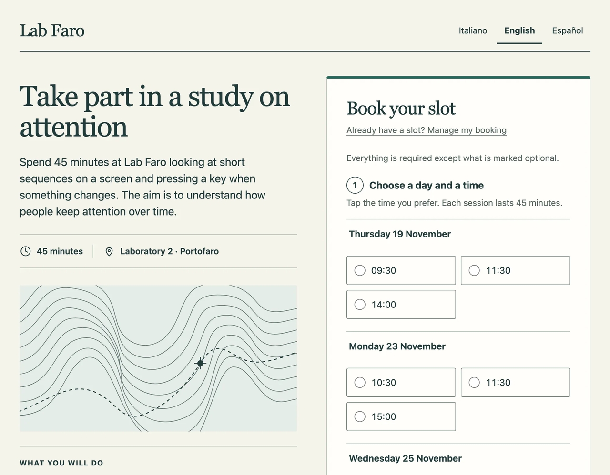
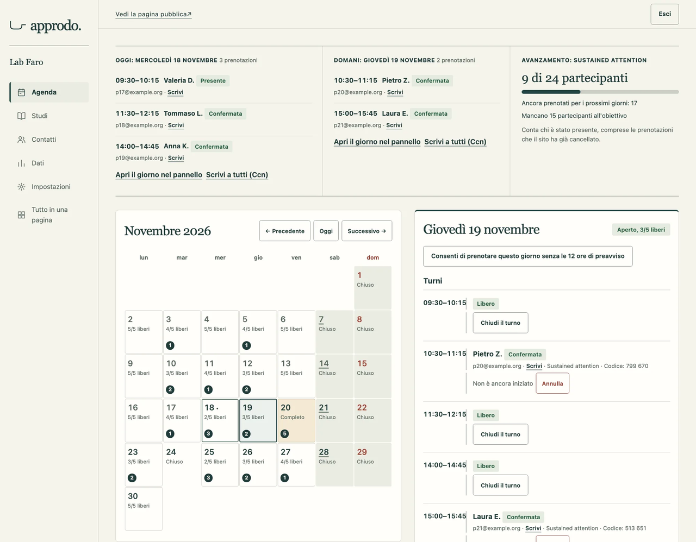
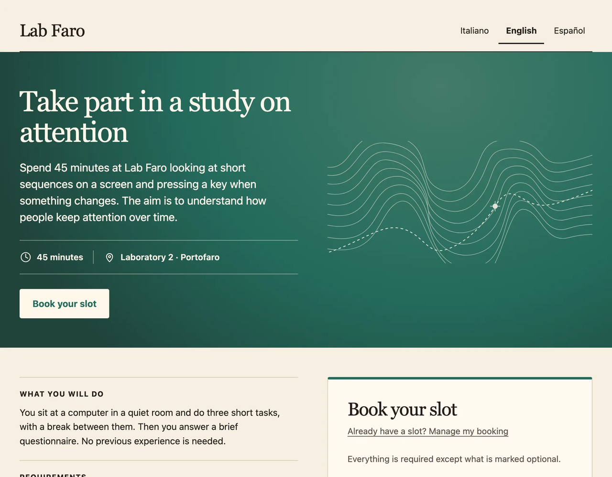

# Approdo: bookings for lab studies

*Italiano: [README.it.md](README.it.md)* · Product website: <https://nerln.github.io/approdo/>

Approdo is a booking site for people who take part in a lab study (user tests, experiments, virtual reality sessions).
Participants pick a day and a time on a public page; the researcher opens days and slots, marks attendance and exports counts in a private dashboard.
You configure it by editing **one file** (`site.config.js`) and publish it on Cloudflare for free, **without installing anything**.

[](https://deploy.workers.cloudflare.com/?url=https://github.com/nerln/approdo)





Sessions can last any length, with fixed start times that you choose (for example 10:00, 11:00 and 12:00 for 50-minute sessions).

## What it does

- Participants book a day and a time on a public page, in Italian, English or Spanish, and confirm by e-mail (or at once, without e-mail).
- The researcher opens days and times, marks attendance, cancels with a message and exports counts in a private dashboard.
- Several studies, a consent sheet per study, an optional list of people who want to hear about future studies, optional reminders.
- Everything specific to the lab lives in one file, `site.config.js`.
- Free and open source. Two conditions: cite Approdo in what you publish, and the line "Made with Approdo by nerln" stays visible at the bottom of the public pages
  ([LICENSE](LICENSE)).
- An anonymous usage count, on by default and switched off with one line (below).

## What leaves your installation

Almost nothing, and what does leave is written here. Once a day, when the researcher opens the dashboard (or when the daily reminder
call of the mail relay arrives), your installation sends **one anonymous report** to a small collector run by the author of Approdo.
The report holds three values: a random identifier that your installation makes the first time (it is not derived from your site
address, your lab name or any key), the version of Approdo, and the number of sessions marked as attended since the site started.
It holds **no site address, no lab name, no study name, no participant data and no language**. The product website shows the
totals ("N labs use Approdo"); an installation is counted from the second day it reports, and the total number of sessions is published only while at least
three installations that have reported for a week or more are active, so
that no lab's figure ever appears alone.

One more fact, stated plainly: Cloudflare adds a `CF-Worker` header to every request that a Worker makes, and the header names the
zone of the sender (for example your `workers.dev` subdomain). So that name travels with the report. The collector never reads,
logs or stores it, nor the IP address, nor the user agent, and its source is in [`stats-collector/`](stats-collector/) for you to check.

**To switch the count off**, write one line in `site.config.js` and deploy: `usageCount: false`. Nothing else changes. The dashboard
(Settings) always says whether the count is on or off and when the last report was attempted. Details:
[docs/privacy.md](docs/privacy.md).

## In 4 steps

1. **Press the button** above. Sign in to Cloudflare (a free account is enough, you create it if you do not have one) and to GitHub.
   The Cloudflare form shows, in order: the project name (it is the name of the Worker and part of the site address), the name of
   the repository that will be created in your GitHub, the name of the D1 database, the fields for passwords and keys
   (`ADMIN_PASSWORD`, `MAIL_RELAY_URL`, `MAIL_RELAY_KEY`, `ADMIN_EMAIL`, `TURNSTILE_SITEKEY`, `TURNSTILE_SECRET`) and, in the
   advanced settings, the deploy command. **Fill in one thing only: `ADMIN_PASSWORD`, a password of at least 16 characters** (a long
   sentence is fine: it is the one you will type to enter `/admin`). Leave the other five fields as they are: the sample values they
   propose (`change-me...`, `PASTE-YOUR-ID...`, `studio@example.org`) are ignored by the site, as if they were not there. The names of the project, repository and database
   can stay as proposed. **Do not change the deploy command** (it is `npm run deploy`, that is `wrangler deploy`: it also creates
   the database tables by itself on the first visit). Press the button to deploy: Cloudflare copies the repository into your GitHub,
   creates the database and publishes the site; it is online in a couple of minutes. If you do not remember the address, you find it
   in the Cloudflare dashboard (Workers & Pages, your project).
2. **Make it yours.** In your *new* repository on GitHub open `site.config.js`, press the pencil and replace the sample values with
   yours: `brand` (the short name), `org` (group, university, department, e-mail signature), `responsible` (who is responsible
   for the data), `contactEmail` (a group address), `place` (where you receive participants, in every language), `sessionMinutes`,
   `slotMinutes` and `defaultTimes` (length and start times) and `studyName` (what you call your study, for example "reading
   study"). `baseUrl` is not needed: the site uses the address it is visited at. Then **Commit changes**.
   **As long as the sample values (Lab Esempio, Nome Cognome, studio@example.org, Via Esempio...) are still there, the site shows
   "This site is not configured yet" instead of the form and takes no bookings**: this is on purpose, so that nobody books a lab that
   does not exist. **How to see that the change worked:** wait a minute or two (Cloudflare publishes again on every commit), reload
   the site: the notice is gone and your name, your place and, in the "Book your slot" card, the sentence "There are no free slots
   right now" appear (until you open some days in step 3). If nothing changes, open the Cloudflare dashboard, Workers & Pages, your
   project, and the list of deployments (Deployments / Builds): the log of the last one says whether it failed and, if a value of
   `site.config.js` is wrong, it prints a line that starts with `site.config.js:` and names the key to correct. The "Set-up" list in
   the Settings of `/admin` also lists, one by one, the keys that still hold the sample value.
3. **Open `/admin`** (the site address followed by `/admin`). You see a page with a "Password" field: type the one from step 1. Inside,
   open the days on which you receive participants. If you see **"Administration is disabled"** instead, the password was not
   saved or it is shorter than 16 characters: in the Cloudflare dashboard open the project, Settings, Variables and Secrets, add (or
   replace) `ADMIN_PASSWORD` as a Secret with a sentence of at least 16 characters and save: it applies at once, without publishing
   again.
4. **Optional:** confirmation e-mails and reminders ([docs/posta.md](docs/posta.md)) and the anti-bot check (below, "Turnstile").
   Without e-mail the site works all the same: bookings are confirmed at once and no message is sent, and the public pages say so (they tell people to keep the link of the page and to ask in person, not to look for an e-mail). The "Set-up" list in the
   Settings of the dashboard tells you what is left to do.

The button runs `npm run deploy` on a fresh copy, with the database created by Cloudflare and the tables created by the site. If the button does not work on your account, use the agent path (`AGENTS.md`).

Before you announce the site to participants read "Privacy and obligations" below: the privacy text is a starting point.

## Two other ways

**With an AI coding agent** (Claude Code, Codex and similar; also useful if you have no GitHub account or if you need the database
in the European Union). Give the agent a folder with this repository and write:

> Follow AGENTS.md and put this site online. Ask me for whatever you need.

`AGENTS.md` is written for the agent: commands, order, how to check each step and what to ask you. **You type the passwords yourself**, in
a terminal, without telling them to the agent.

**By hand**, from the terminal (needs Node.js 22 or newer, https://nodejs.org). First replace the sample values in `site.config.js`
(the script stops and lists them as long as one is left):

```
npm install
node scripts/setup.mjs --project name-of-the-site
```

The script checks `site.config.js`, runs the tests, logs you in to Cloudflare, creates the database **in the European Union**,
publishes the Worker (the site creates its own tables on the first visit: there is no migration to run) and prints the commands for
the passwords (`npx wrangler secret put ...`). You can run it again without harm; with `--dry-run` it shows the commands without
running them. The steps one by one are in `AGENTS.md`.

## Honest notes

- **Why not GitHub Pages.** GitHub Pages serves static files only. This site needs a server that applies the rules (one slot per
  person, minimum notice, busy times), a database, e-mail sending and a password-protected dashboard. That is why it runs as a Worker
  on Cloudflare (free plan, with D1 as the database). The code is on GitHub, but Cloudflare runs it.
- **The database made by the button is not guaranteed to be in the European Union.** With the button, Cloudflare creates the database
  without the "EU jurisdiction" option. If your lab needs that guarantee, use the agent path or the script: they create the database
  with `--jurisdiction eu`. The jurisdiction can only be chosen when the database is created.
- **The privacy text is a starting point.** It is generic text written for any research study: rewrite it for yours and have it
  reviewed by the data protection officer of your institution. Until you do, the dashboard keeps a "To do" line.
- **Security and known limits:** [SECURITY.md](SECURITY.md). **Licence:** the [Attribution Assurance License](LICENSE) with one added
  condition. It asks for two things. A visible credit to the author: on a site made with Approdo it is the line at the bottom of the
  public pages, "Made with Approdo by nerln" with its link; keep it visible (you may restyle it). And a citation: a publication,
  thesis or report on a study that used Approdo cites it ([CITATION.cff](CITATION.cff)). The citation condition is an addition to
  the standard licence text. The photo of the landing page has a separate licence ([CREDITS.md](CREDITS.md)).

## How it works, on one screen

**The participant** opens the site address (also from a QR code on a poster), in the language of the browser or one they choose. They
read what the study is about, pick a day and a time among the open ones, type a name or alias and an e-mail address, tick the
declarations and book. They receive an e-mail with a button (or a six-digit code) to confirm within two hours, then the confirmation
e-mail with day, time, place and a calendar file, and the day before a reminder. They can cancel with a link. The site uses no
cookies for people who book.

**The researcher** opens `/admin` with a password. They see a calendar, open days (with the start times they chose) or whole groups
of weeks, close single times, see who booked for today and tomorrow, mark who came and who did not, cancel with a message, download
a CSV and prepare an invitation for future studies. They receive an e-mail for every booking and every cancellation.

Everything the site says (texts, e-mails, privacy text) and everything specific to the lab (names, place, length, times,
languages) is in `site.config.js`.

## What you need

- A **free Cloudflare account** (https://dash.cloudflare.com/sign-up) and a **GitHub account** (for the button).
- Optional, for e-mail: a **Gmail account of the study, not a personal one** (the e-mails leave from it and the replies arrive
  there). A small Google program (Apps Script, in `apps-script/Code.gs`) sends them; with a normal Gmail account the limit is about
  100 e-mails a day.
- Only for the by-hand path or to try the site locally: **Node.js 22 or newer**.

## Configure everything in `site.config.js`

`site.config.js` starts as a copy of `config/example-lab.config.js` (an invented lab, "Lab Esempio", with 50-minute sessions). The
file is commented line by line: replace the sample values (`Nome Cognome`, `studio@example.org`, `Lab Esempio`, the place...) with
yours; as long as one is left the site says "not configured yet" and takes no bookings. If a value is wrong the site stops at start-up
with a message that names the key, and `node scripts/setup.mjs` and the tests report it before you publish. The folder `config/` has
two complete configurations ready to use as models (`fixture-lab.config.js` is a fictional lab used by the tests,
`example-lab.config.js` is the sample).

| Key | What it is | Default |
|---|---|---|
| `brand` | Short name in the header and as the sender name of e-mails | required |
| `org.group` | Research group. A text, or an object with one text per language (`{ it: "...", en: "..." }`): the same goes for the other three `org.*` keys | required |
| `org.university` | University or institution. It can also be an object with one text per language, so that the English pages are in English | required |
| `org.unit` | Department or school (`""` if you do not want one) | `""` |
| `org.signature` | The line that signs every e-mail | required |
| `responsible` | Name of the person responsible, written in the privacy text | required |
| `contactEmail` | Address that receives replies to the e-mails and the "new booking" notices. It is not shown on the public pages. The `ADMIN_EMAIL` variable on Cloudflare replaces it | required |
| `baseUrl` | **Optional.** Public address of the site, without a final `/`, for those with their own domain who want links that never change. Without it (and without the `BASE_URL` variable, which wins) every link (e-mails, calendar files, preview tags) uses the address the request came to | not set |
| `timeZone` | IANA time zone, for example `Europe/Rome`. All times are local time in this zone | required |
| `languages` | Languages offered: `"es"`, `"en"`, `"it"`. The first is the default. Only these get the language switch and the short paths `/it`, `/en` | required |
| `adminLanguage` | Language of the dashboard: `"es"` or `"it"` | `"es"` |
| `sessionMinutes` | How long the session lasts, as told to the participant (pages, e-mails, calendar event) | required |
| `slotMinutes` | How much calendar a booking takes: session plus break. It must be at least `sessionMinutes` and at most 720 (12 hours). Two slots of the same day must start at least this far apart | required |
| `defaultTimes` | Start times of a newly opened day (`HH:MM`, any minutes, at most 12, at least `slotMinutes` apart, the last one must end before midnight). You change them later from the dashboard | required |
| `minNoticeHours` | Minimum notice to book, in hours | `12` |
| `shortNoticeMinutes` | Notice when the researcher grants the exception for one day. It is also the minimum notice of the "Available today" mode: one number for both | `20` |
| `daysAhead` | How many days ahead days can be opened (56 = 8 weeks) | `56` |
| `flexDefaultUntil` | Closing time proposed by the "Available today" mode | `"17:00"` |
| `place.long` | Full address, one per language: e-mails, calendar events, booking card | required |
| `place.short` | Short label on the landing page, one per language | required |
| `place.room` | How the texts call the lab ("Lab Esempio room"), one per language | required |
| `noLinkDomains` | Mail domains (for example `["example.edu"]`) whose filter drops messages that contain links: people with an address there get e-mails with a code and no links. The `NOLINK_DOMAINS` variable replaces it | `[]` |
| `bookingRetentionDays` | Days after the slot when the booking data is deleted | `30` |
| `contactMonths` | Months that a person who asked to hear about future studies stays on the list | `24` |
| `palette` | `"paper"` or `"theatre"`: see "Design" | `"paper"` |
| `accent` | The colour of the lab, `#rrggbb` | `"#246b5c"` |
| `hero.art` | `"contour"` (a line drawing) or `"hologram"` (the holographic menu drawn over the photo) | `"contour"` |
| `hero.image`, `hero.width`, `hero.height` | The photo of the landing page (a file inside `public/`, a path such as `/photo.webp`: only letters, digits, `.`, `-`, `_` and `/`) and its size, or `null` for no photo | `null` |
| `hero.ogImage` | A 1200x630 image for link previews (a file in `public/`, same kind of path), or `null` | `null` |
| `hero.creditHtml` | Credit line of the photo, HTML written by you, one per language, or `null`. The photo that comes with the template requires the credit | `null` |
| `twoStudies` | `true`: the site presents two studies one after the other ("Two studies" card and an active-study switch in the dashboard). `false`: one study only, the card and the switch disappear and the texts of `study1` are always used | `true` |
| `declarations.epilepsy` | `true`: a box "I do not have epilepsy and have never had it" (checked on the server too), a line in the requirements, the terms and the privacy text. `false`: none of this | `true` |
| `declarations.vestibular` | `"study2"`: the declaration about vestibular disorders is asked only for the second study (needs `twoStudies: true`); `"always"`: always; `"never"`: never, and mentioned nowhere | `"study2"` |
| `privacyReviewed` | Write `true` only after the data protection office of your institution has reviewed the privacy text. While it is `false`, the "Set-up" list of the dashboard has a "To do" line and `scripts/setup.mjs` prints a warning | `false` |
| `legacyPaths` | `false`: pages in Italian and English use the addresses `/terms`, `/privacy`, `/book`, `/manage`, `/unsubscribe` (Spanish pages `/condiciones`, `/privacidad`, `/reservar`, `/gestionar`, `/baja`; both always work). `true`: Spanish addresses everywhere, for sites whose links already exist | `false` |
| `usageCount` | `true`: once a day the installation sends one anonymous report (random identifier, version, number of attended sessions) to the author of Approdo; see "What leaves your installation". `false`: nothing is ever sent | `true` |
| `studyName` | What the study is called in e-mail subjects, in the calendar event title, in the invitation and in the default texts: one text, or one per language (`{ it: "studio sulla lettura", en: "reading study", es: "..." }`). It must read after "a" ("un/uno" in Italian) | "research study" and its Italian and Spanish equivalents |
| `minAdminPasswordLength` | Minimum length of `ADMIN_PASSWORD`: a shorter password counts as not set (the dashboard stays closed and says why). Do not lower it on a real site | `16` |
| `texts` | Replacements of the public texts per language: description of the study, requirements, privacy text. Which keys describe the study and need rewriting: [docs/testi.md](docs/testi.md). The format: [docs/configurazione.md](docs/configurazione.md) | `{}` |

Details of every key, how to rewrite the texts and the most common errors: [docs/configurazione.md](docs/configurazione.md) (in Italian).

### Example 1: 50-minute sessions, one start every 60 minutes

The session length and the distance between start times are two separate settings. A session lasts 50 minutes (`sessionMinutes`). Between the start of one and the start of the next
at least 60 minutes must pass (`slotMinutes`), so there are 10 minutes between sessions. The start times are the ones you choose:

```js
sessionMinutes: 50,
slotMinutes: 60,
defaultTimes: ["10:00", "11:00", "12:00"],
```

The participant reads "from 10:00 to 10:50" (the length of the session); the calendar of the site treats that slot as busy until
11:00, so no other booking can start before. Every open day offers these three times and no others: if one day you need one more or one
less, you open or close it from the dashboard. If you write times that are too close (for example 10:00 and 10:30) the site refuses
the configuration with a message that explains why.

### Example 2: a 45-minute session, one start every 45 minutes

```js
sessionMinutes: 45,
slotMinutes: 45,
defaultTimes: ["09:00", "09:45", "10:30", "11:15", "13:00", "13:45", "14:30"],
```

There is no break: `slotMinutes` equals `sessionMinutes` and a slot starts when the previous one ends. Times can have any minute:
they do not have to be round.

## Design

The look is warm paper, serif headings, thin rules, a light and a dark theme and no downloaded font. The colour of your lab is the key
`accent` of `site.config.js` (`#rrggbb`, default petrol green; the site serves it as `/theme.css`). The drawing of the landing page is
`hero.art` (`"contour"` or `"hologram"`), or your own photo `hero.image`. At the bottom of the public pages a discreet "Made with
Approdo by nerln" appears: the licence asks you to keep it there (you may restyle it).

There are two palettes, chosen with the key `palette`:

- `"paper"` (default): warm paper and marine ink, as in the images above.
- `"theatre"`: for a lab whose study and posters have a deep red, stage-like identity. Cream paper, warm near-black ink (no green
  tint anywhere) and your `accent` for active items. On the landing page a full-width band in the `accent` colour, with a soft light
  like a curtain under a spotlight, holds the title, the lead, the facts and the call to action in cream text. The photo stands
  beside it (below it on a phone), directly on the band with no panel behind it: it must be a cut-out with a transparent
  background. With `hero.art: "hologram"` the decorative overlay and its one-shot animation are drawn over the photo. The band
  looks the same in the light and the dark theme, and its text switches to dark when `accent` is a light colour (for example
  `#f0c040`). The dashboard uses the same inks and cream paper, with the accent for the active items.



`node scripts/check-contrast.mjs` checks the contrast of both palettes in both themes, also with a colour of your own
(`node scripts/check-contrast.mjs "#rrggbb"`). More in `docs/configurazione.md`.

## The dashboard, day by day

Open `https://<your-site>/admin` and type the password. The dashboard is in the language of `adminLanguage` (here the names are the
Italian ones; the Spanish dashboard has the same elements, see the table in the technical reference at the end).

The dashboard has **five sections**, chosen with the bar at the top (plain links, no script): **Agenda** (today and tomorrow, the
calendar of the month, the chosen day, the next bookings and, if you set a target, the progress of the active study), **Studies**
(texts, declarations and participant target of each study), **Contacts** (the list for future studies and the invitations), **Data**
(the three downloads) and **Settings** (confirmation mode, default times, daily break, tools, set-up). "All on one page" (`/admin?s=all`) shows
all of them one after the other. Every form goes back to the section it came from and the message appears there. In the calendar
Saturday and Sunday have a class of their own: the Sunday number and the column heading are red in both themes, and the accessible
label of every cell gives the day of the week.

- **Opening days.** From the calendar of the month choose a day and open it: it gets the default times. There is also a quick action
  to open the week (Monday to Friday) or 1, 2, 4 or 8 weeks at once. Only future days within `daysAhead` can be opened. A day with
  pending or confirmed bookings cannot be closed: cancel those first.
- **Changing the start times.** For good (for the days you open from now on): Settings, default times, type `HH:MM` separated by
  commas. The site refuses times that overlap (less than `slotMinutes` between two starts) and a last slot that ends after midnight.
  For one day that is already open: in the day panel open or close single times.
- **The notice exception, day by day.** Normally people book at least `minNoticeHours` hours ahead. If one day you want to accept
  last-minute bookings, switch the exception on in the panel of that day: people can then book up to `shortNoticeMinutes` minutes
  before each free slot. Close first the slots at which you will not be there. The same button switches it off.
- **Available today.** If you are in the lab and want to receive someone today, type "from" and "to" (by default until
  `flexDefaultUntil`) and switch it on: the public can book today with `shortNoticeMinutes` minutes' notice (20 by default), in consecutive slots from the current time
  (on a 5-minute grid) up to the time you gave. While it is on, the public sees these times for today and not the normal ones.
- **Daily break.** In Settings (the "Pausa" form): type "from" and "to" (a lunch hour, say) and save. No slot whose session overlaps
  that interval is offered, on any day and in "Available today" too; bookings already made stay as they are. Remove it with the same form.
- **Confirmation mode.** In Settings choose how bookings are confirmed: "By e-mail" (default, with the relay on: the person must
  confirm with the button or the code within two hours, otherwise the place is released) or "At once" (the booking is valid
  immediately; the confirmation e-mail is still sent). Without a mail relay confirmation is always immediate.
- **Today and tomorrow.** At the top you find who booked for today and tomorrow: time, name, status, address, a link to write to
  them and, with two or more people, "Write to all (Bcc)" (addresses in blind copy). The day panel also shows, under every booking,
  which e-mails were sent and which were not.
- **Attendance.** After the slot starts, mark "Present" or "Absent". A person who did not come can be offered, once and by hand, the
  chance to pick another slot. A person who came cannot book the active study again with the same address.
- **Cancelling.** From the dashboard you can cancel a booking with an optional message (500 characters) for the person; the dashboard
  tells you whether the e-mail went out.
- **Data and downloads.** The Data section has three separate blocks, and each says in words whether it contains personal data.
  *Summary without names or e-mail addresses*: one row per study and per week (booked, present, absent, cancelled, not marked) plus a
  total per study with the target; it adds the bookings of now and the weekly counts that the site keeps when it deletes old
  bookings (the `riepilogo` CSV, with the study identifier). Someone who knows who came in a given week could still connect a count
  to a person. *Bookings with names and e-mail addresses* (file `prenotazioni-con-dati-personali-<date>.csv`): alias, e-mail, study,
  date, time, status, language, reminder and whether the e-mail was confirmed. It contains personal data and is for your use as a researcher: the site deletes it
  `bookingRetentionDays` days after each slot, so export first, and delete the file from your computer when the study ends.
  *Contacts who accepted notices*: also personal data (e-mail).
- **List for future studies.** A person who, when booking, asked to hear about future studies joins the list after taking part (or
  after confirming the e-mail), for `contactMonths` months. In the dashboard you see how many people there are, you can export them
  as CSV and prepare an invitation: the site prepares the text and the links that open in your mail program with the addresses in
  blind copy and, at the end, how to unsubscribe. **The site does not send the invitation**: you send it. A person who wants to leave
  the list does it from the unsubscribe page.
- **Studies from the dashboard.** Until you save a study from the dashboard, the studies are the ones of `site.config.js`
  (`twoStudies`, `declarations`, `texts`). The **first save** (even just "New study") copies all
  the studies of the configuration into the `studies` table, **without copying any text**: a row keeps only what differs from the
  built-in text, so saving without changing anything changes nothing. From then on the source is the dashboard: title, description,
  "what you will do" and requirements for each language, the declarations (epilepsy, vestibular disorders), a **participant
  target**, how the study appears in the public list (hidden, later, already done), "Activate this study", "Save and activate this study", "Archive this study"
  (never deleted) and "New study". A refused save, or one made while the study was changing, gives you back the same form with
  what you had typed. How to do it, with the length limits: [docs/studi.md](docs/studi.md). If you have one study and do not want the
  section, do not use it: nothing changes. The built-in texts of the site are rewritten as [docs/testi.md](docs/testi.md) explains.
- **Informed consent sheet.** For every study and language you can fill in from the dashboard the content of the sheet that the person
  signs on paper before the session (title, description, procedure, risks, data, retention, controller, optional permissions) and
  open the page to print on A4 (`/admin/consent?study=<id>&lang=<language>`, which the button of the editor opens for you), black on white and without script: you use the Print command of the browser. An
  empty field prints a cautious built-in text, with square brackets around the parts that only your lab can know. **It is a
  starting point: it must be reviewed by the ethics committee or the data protection office** of your institution. The editor shows
  what the public page says and warns if the sheet does not name epilepsy when the form asks about it. On the sheet the block of the
  person (name in capitals, date, signature) comes before the researcher's (a switch puts the researcher's block first), at
  the bottom there is a line with the name of the study and the date of the last change, and the strip on screen counts the square
  brackets that are left. Details: [docs/consenso.md](docs/consenso.md).
- **Progress.** If the active study has a target, at the top of the Agenda you see "N of M participants", a bar, how many are still
  booked for the coming days and how many are missing. Bookings marked "Present" count as done, including those that the site has
  already deleted (it keeps only weekly counts: see [docs/privacy.md](docs/privacy.md)). For participants you ran without the booking page
  you set "Participants done outside the website" (in the study form or in a small form under the progress); it is added to the done count.
- **Tools.** "Send a test e-mail" (to `ADMIN_EMAIL` if it is set, otherwise to `contactEmail`), "Send tomorrow's reminders" (useful to try), and the "Set-up" list that says
  whether password, relay, automatic reminders and the anti-bot check are in order.

## The limits that protect the site

| Protection | Value | Where to change it |
|---|---|---|
| Minimum notice to book | 12 hours | `minNoticeHours` in `site.config.js`; exception for one day or "Available today" from the dashboard |
| One live booking per e-mail address | always | The normalised address is evaluated (capitals, `+label`, Gmail dots); a person who already came cannot book the active study again. Not configurable |
| Place held while waiting for confirmation | 2 hours (or until the slot starts, for last-minute bookings) | In the code (`PENDING_MS` in `src/app.js`) |
| Requests per network | 20 requests/10 min per network address (only a fingerprint with a daily salt is kept) | In the code (`RATE_MAX` in `src/app.js`). A class on the same network shares one address: raise it if needed |
| Confirmation e-mails | at most 30 requests an hour for the whole site; with 80 e-mails in 24 hours new bookings are not accepted, with 50 the notices to you for every confirmation stop | In the code (`MAIL_BRAKE_MAX` in `src/app.js`, `MAIL_DAY_MAX` and `MAIL_ADMIN_SKIP` in `src/mail.js`). Meant for the Gmail limit of 100 e-mails a day |
| Wrong code attempts | 5 every 15 minutes per e-mail | In the code (`CODE_MAX` in `src/app.js`) |
| Dashboard login | lock after 5 failures in 15 minutes | In the code |
| Anti-bot check | a hidden trap field, at least 4 seconds between opening and sending the form, disposable e-mail addresses refused; plus Cloudflare Turnstile if you switch it on | Turnstile: see below |

The values "in the code" are constants in `src/`: changing them is a programmer's change (ask your agent) and the regression test
suite (`npm test`) pins the original values, so that test has to be updated together with the constant.

**Switching on Turnstile (the Cloudflare anti-bot check, optional).** In the Cloudflare dashboard: Turnstile, Add widget, any name,
the hostname of the site address (for example `approdo.your-name.workers.dev`), Managed mode. You get a site key and a secret key.
Set them as secrets of the Worker: in the dashboard (Workers & Pages, your site, Settings, Variables and Secrets, replace the
`change-me` values) or from the terminal:

```
npx wrangler secret put TURNSTILE_SITEKEY
npx wrangler secret put TURNSTILE_SECRET
```

They apply at once, without publishing again. Both are needed, otherwise the check stays off. At first the dashboard shows it
"under observation": it blocks nobody until a check has succeeded at least once. With Turnstile on, people who book need JavaScript
in their browser.

## Privacy and obligations

- **The privacy text on the site is a starting point.** It is written in general terms. Every institution must have it checked by
  its own data protection officer (DPO) and adapt it (`texts` in `site.config.js`, see [docs/testi.md](docs/testi.md)) before
  announcing the site; when that is done, write `privacyReviewed: true`. The same goes for the terms of participation and for the
  declarations on the form (by default, no epilepsy and no vestibular disorders; you switch
  them off with `declarations`).
- **If the repository is public** (with the button it is). The code can be published without risk for the site: the passwords
  (`ADMIN_PASSWORD`, the key and address of the mail relay, Turnstile) live only in the Cloudflare secrets and in `.dev.vars`
  (ignored by git), never in a file of the repository; the `database_id` in `wrangler.jsonc` is not a secret; the site holds no
  participant data, which lives in the database. Everything you write in `site.config.js` does become public, including
  `contactEmail` and `responsible`: use a group address (not a personal one) and write a name only if the person agrees.
- **What is kept.** For every booking: name or alias, e-mail, day and time, status, language and the dates of creation and
  confirmation. No IP address and no participant code: booking data is not linked to study data. A fingerprint of the network
  address, with a daily salt, is kept for one hour (request limit). The list for future studies keeps only e-mail and language.
- **For how long.** Bookings are deleted `bookingRetentionDays` days after the slot (cancelled ones too: cancelling does not delete
  sooner). Unconfirmed ones are deleted after 2 hours. The log of sent e-mails (without text) after 60 days. Contacts for future
  studies after `contactMonths` months or when the person leaves the list. Before bookings are deleted the site counts them per week
  in the `tallies` table (study, week, status: no names, no e-mail addresses), and those counts stay.
- **Deleting the data of a person who asks.** Before the automatic term, it is done by hand: [docs/privacy.md](docs/privacy.md) has
  the commands and the precautions.
- **The anonymous usage count.** Once a day the installation reports a random identifier, the version and the number of attended sessions to the author of Approdo; nothing about the site, the lab or the participants. It is on by default and `usageCount: false` switches it off. See "What leaves your installation" above and [docs/privacy.md](docs/privacy.md).
- **Who processes the data.** Cloudflare (site and database; in the European Union only if the database was created with the EU
  jurisdiction, see above) and Google (sending e-mails, only if the relay is on). This has to be stated in the privacy text and
  assessed by the DPO.

More details in [docs/privacy.md](docs/privacy.md).

## If something is wrong

**E-mails do not arrive at university addresses.** Some university mail filters silently drop messages that contain links. Add the
domain to `noLinkDomains` (for example `["example.edu"]`) and publish again: people with an address in that domain get e-mails
without links, with a six-digit code to type in the "Manage my booking" page. If e-mail reaches nobody, look in the spam folder
first, then in the day panel at the "E-mail:" line under the booking, which says what went out and the relay error. `bad signature`
means that the relay key in Apps Script and `MAIL_RELAY_KEY` on Cloudflare differ; `quota`, that the daily limit is used up. Other
cases in [docs/posta.md](docs/posta.md).

**The daily e-mail limit.** A normal Gmail account sends about 100 e-mails a day (Google Workspace accounts more, by Google's
rules). The site stops before that: with 80 e-mails in 24 hours it accepts no new bookings until the number goes down, and from 50
it no longer notifies you on every confirmation. The count is in the "Set-up" list. A reminder or a confirmation for bookings
already made always has priority. A large group on the same day (a class) can use up the limit: spread the invitations.

**The anti-bot check.** If a legitimate person cannot book: "Too many attempts" (the page title; the text says "too many requests") means their network made more than 20 requests in 10
minutes (a class on the same network); wait or raise `RATE_MAX`. With Turnstile, check that the hostname of the widget is identical
to the site's and that the person is not blocking Cloudflare scripts. A form sent less than 4 seconds after it was opened is
refused: trying again is enough.

**The site says the database is missing, or `/admin` says "Administration is disabled".** The database is not bound to the Worker, or
the password `ADMIN_PASSWORD` is missing, or it is still the sample one (`change-me...`), or shorter than `minAdminPasswordLength`
(16): set it as step 3 explains, and see the last table of `AGENTS.md`.

## Try it locally, without Cloudflare

The simplest way to see the site:

```
node scripts/preview.mjs
```

At start-up it prints, in English, the address (`http://localhost:8799`), the address of the dashboard (`/admin`) and the password to
enter it (a new random one at every start, valid only for that preview). The database is in memory (it is emptied at every start),
no e-mail is sent and nothing online is touched; six weekdays are already open with the times of `site.config.js`. Stop it with
Ctrl+C. With another port: `node scripts/preview.mjs 8801`. With a fixed clock, to try attendance, the purge and the summary without
waiting: `node scripts/preview.mjs --now 2026-11-16T10:00:00+01:00` (an ISO instant with its time zone).

To try it instead on the real Cloudflare engine (local D1 database; no login and no network needed), in this checked sequence:

```
npm install
echo "ADMIN_PASSWORD=a-long-local-password" > .dev.vars
npm run dev
```

`npm install` downloads Wrangler, the second line writes a test password for `/admin` (at least 16 characters) in `.dev.vars` (a
file ignored by git: do not repeat this line if the file already exists) and `npm run dev` starts the site at http://localhost:8787
with a local database (the `.wrangler/` folder) that is empty at first: the site creates its own tables on the first request, with no
migration command. To use another port: `npm run dev -- --port 8790`. From another terminal: `curl -s -o /dev/null -w "%{http_code}\n" http://localhost:8787/`
and the same with `/admin` must print `200`; a page that does not exist gives `404`. To stop it: Ctrl+C. The local database is
empty: open some days from `/admin` to see slots. The values in `.dev.vars.example` (`change-me...`) count as not set: with those
the dashboard stays closed and there is no e-mail and no anti-bot check.

The tests:

| Command | What it proves |
|---|---|
| `npm test` | the regression suite, against a complete fictional lab (`config/fixture-lab.config.js`): the behaviour the tests pin does not change |
| `npm run test:generic` | the suite that does not depend on the configuration, against the sample (`config/example-lab.config.js`) |
| `npm run test:variants` | the same suite against each of the small configurations in `config/test-variants/` (declarations off, one study only, other languages, and `realistic-edit`: the sample with real values, as someone who filled it in leaves it) |
| `npm run test:all` | the three commands above, one after the other |
| `node scripts/test.mjs site.config.js --suite test-generic` | **your** configuration |

Each one works on a temporary copy and does not change your files. To print the poster with the QR code: `npm install` and
`npm run qr -- https://your-site/`.

## Updating, GitHub and tearing down

To update the site to a new version of the template (the database updates itself on the first visit) see
[docs/aggiornare.md](docs/aggiornare.md). If you want every change pushed to GitHub to publish the site by itself, after the tests,
there is an optional flow in `.github/workflows/deploy.yml` (instructions in the file). To switch everything off: `AGENTS.md`,
section "Tearing down".

## Map of the files

| File | What it is for |
|---|---|
| `site.config.js` | **The only file to edit** |
| `config/` | Two complete example configurations (`fixture-lab.config.js`, the fictional lab of the tests, and `example-lab.config.js`) and, in `config/test-variants/`, the small variants used by the tests |
| `AGENTS.md` | The publishing procedure for an AI agent |
| `scripts/setup.mjs`, `setup.sh` | Terminal installation (database in the EU) of everything that needs no password. It stops (exit code 1) while `site.config.js` holds a placeholder, and warns while `privacyReviewed` is `false` |
| `scripts/preview.mjs` | The local in-memory preview |
| `scripts/check-contrast.mjs` | Contrast check of both palettes in both themes |
| `wrangler.jsonc` | Configuration of the Cloudflare Worker: name, D1 database, static files. With the button Cloudflare creates the database; the script writes the `database_id` here |
| `package.json` | Commands (`npm run deploy`, which is only `wrangler deploy`, `npm run dev`, `npm run build:schema`, the tests) and the descriptions of the fields the button asks for |
| `PUBLISHING.md`, `scripts/set-owner.mjs` | For whoever publishes a copy of the repository: puts your GitHub account in the repository address, in place of the placeholder or of the account of whoever published the copy you forked |
| `LICENSE`, `CREDITS.md`, `SECURITY.md`, `CITATION.cff` | Licence of the code (Attribution Assurance License: BSD terms plus a visible credit), separate licence of the photo, security and known limits, how to cite Approdo |
| `apps-script/Code.gs` | The mail relay for Google Apps Script |
| `schema.sql`, `src/schema.js`, `src/migrate.js` | Database tables: `schema.sql` is the only source, `src/schema.js` is its generated copy (`npm run build:schema`) and `src/migrate.js` creates and upgrades them by itself on the first request |
| `src/`, `public/` | The code of the site (not edited to configure it). `src/usage.js` is the anonymous usage count |
| `stats-collector/` | The source of the small Worker that receives the usage reports and publishes the totals. It is not deployed with your site: you do not need it |
| `test/`, `test-generic/` | The tests |
| `docs/` | Guides (in Italian): configuration, study texts, studies from the dashboard ([docs/studi.md](docs/studi.md)), consent sheet ([docs/consenso.md](docs/consenso.md)), mail, privacy, updates. `docs/img/` holds the images of this file |

## Technical reference

For developers or for the AI agent. The behaviour described here is that of the code in `src/`.

- **Stack.** A Cloudflare Worker with static files (`wrangler.jsonc`: `src/index.js` answers every request and calls `src/app.js`; the
  files of `public/` go through `env.ASSETS`), D1, HTML generated by the server with a strict Content-Security-Policy (no inline
  style or script), no cookie for participants. The dashboard uses only HTML and CSS. Every interpolated value is escaped and every
  SQL statement has bound parameters. The palette and the accent reach the pages as `/theme.css` and a class on `<body>`, never as a
  style attribute.
- **E-mail.** An e-mail about a booking goes through `sendLogged` (`src/mail.js`), which sends and writes a row in `mail_log` (kinds
  `confirm_request`, `confirmed`, `reminder`, `cancelled`, `noshow`, `admin`, `test`; rows deleted after 60 days). Reading and
  writing the log tolerate a missing table. If the relay fails during booking in the "By e-mail" mode, the booking is deleted and the last error stays in
  `settings.mail_fail_last`, shown in the "Set-up" list. In the "At once" mode the booking stays confirmed and only the error is recorded. The relay signs the body with HMAC-SHA256 (the signature travels in the
  `?sig=` parameter); the `REPLY_TO` property of the script gives the address that receives replies; when the quota is used up the
  relay answers `{ok:false, error:'quota'}`.
- **Reminders.** The site has no cron of its own: the relay in Apps Script calls `POST /cron/remind` once a day (signed with the same
  key). Every booking is "claimed" before sending and released if sending fails. The result (`at`, `sent`, `failed`) is in
  `settings.cron_result`; the "Set-up" list marks it "Done" if the call is less than 26 hours old.
- **Purge.** Opportunistic on every dynamic request, at most once a minute: expired pending bookings, bookings older than
  `bookingRetentionDays` (before deleting them it counts them per week in the `tallies` table, in the same `db.batch`), rate-limit and
  login-attempt rows older than an hour, the e-mail log older than 60 days.
- **Database.** No migration to run: the automatic database creation of Wrangler happens only during deploy, so "apply the migrations,
  then deploy" would not work on a fresh clone. `src/migrate.js` (`ensureSchema`) reads once per instance the `schema_version` row of
  `settings`: if the table is missing it creates everything with a `db.batch` of `CREATE ... IF NOT EXISTS` statements (taken from
  `src/schema.js`, generated from `schema.sql`), if the version is older it runs the idempotent upgrades, and then asks no more
  questions. Schema version 2 adds `studies` (the studies managed from the dashboard: `data` is JSON with name, target, archived,
  declarations, public state and only the texts that differ from the built-in ones; empty until you save a study) and `tallies`;
  version 3 turns `tallies` into counts **per ISO week** (study, Monday, status: no names, no e-mail addresses, never deleted; the
  per-day counts that already existed are summed into the Monday of their week). How to change the schema in future:
  [docs/aggiornare.md](docs/aggiornare.md).
- **Dashboard labels.** With `adminLanguage: "es"` the sections are called "Hoy y mañana" (Italian: "Oggi e domani"),
  "Próximas reservas" ("Prossime prenotazioni"), "Ajustes" ("Impostazioni"), "Puesta en marcha" ("Messa in funzione"), "Invitar"
  ("Invita"), "Disponible hoy" ("Disponibile oggi"), "Asistió" / "No vino" ("Presente" / "Assente"). The sections: "Agenda",
  "Estudios" ("Studi"), "Contactos" ("Contatti"), "Datos" ("Dati"), "Ajustes" ("Impostazioni").
- **Tests.** `scripts/test.mjs [path-to-config] [--suite test|test-generic]` copies the project into a temporary folder, writes the
  chosen configuration there as `site.config.js` and runs `node --test`: the configuration is never changed at run time.
- **Variables and passwords on Cloudflare.** Passwords (`npx wrangler secret put NAME`, or the dashboard): `ADMIN_PASSWORD`,
  `MAIL_RELAY_URL`, `MAIL_RELAY_KEY`, `ADMIN_EMAIL`, `TURNSTILE_SITEKEY`, `TURNSTILE_SECRET`: they are the ones the button asks for
  (the list is `.dev.vars.example`, the descriptions are in `package.json`, field `cloudflare.bindings`). A value still equal to the
  sample (`change-me...`) or empty counts as not set (`src/env.js`). Optional, and usually better written in `site.config.js`:
  `BASE_URL` (optional: normally not needed, see `baseUrl`), `NOLINK_DOMAINS` (if you put them in the dashboard as plain variables,
  every deploy erases them; as secrets they stay). Locally, the same way, in `.dev.vars` (start from `.dev.vars.example`; it must
  never be committed).

## Credits

Built by nerln. The photo of the landing page has its own licence: [CREDITS.md](CREDITS.md).

If you use Approdo in a study, cite it (the licence asks for it): [CITATION.cff](CITATION.cff) has the reference, and GitHub shows it under
"Cite this repository".
